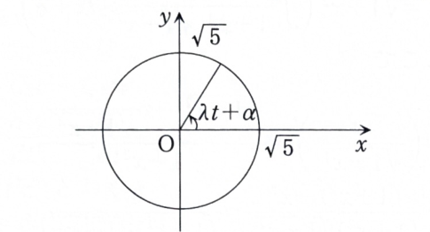

3C-04

$x$ および $y$ は $t$ の関数で、次の連立微分方程式を満たしている。ただし、$\lambda$ は正定数である。

$$
\frac{dx}{dt}=-\lambda y,
\qquad
\frac{dy}{dt}=\lambda x
$$

---

## (1)

$t=0$ で $(x,y)=(1,2)$ のとき、$x,y$ をそれぞれ $t$ の式で表せ。

---

## (1) 解答

> 第1式をもう一度微分し、第2式を代入すると $x$ だけの単振動方程式になる。その後、第1式から $y$ を復元する。
>
> 行列指数を用いる方法もあるが、2階方程式への消去が最も初等的である。

第1式

$$
\frac{dx}{dt}=-\lambda y
$$

を $t$ で微分する。代入前の文字式は

$$
\frac{d^2x}{dt^2}
=
-\lambda\frac{dy}{dt}
$$

である。第2式

$$
\frac{dy}{dt}=\lambda x
$$

を代入すると、

$$
\frac{d^2x}{dt^2}
=
-\lambda(\lambda x)
=
-\lambda^2x
$$

となる。したがって、

$$
\frac{d^2x}{dt^2}+\lambda^2x=0
$$

である。

特性方程式は

$$
u^2+\lambda^2=0
$$

であり、

$$
u=\pm i\lambda
$$

だから、

$$
x=A\cos\lambda t+B\sin\lambda t
$$

となる。

第1式から $y$ を求める。代入前の文字式は

$$
y=-\frac1\lambda\frac{dx}{dt}
$$

である。$x$ を微分すると、

$$
\frac{dx}{dt}
=
-\lambda A\sin\lambda t
+
\lambda B\cos\lambda t
$$

だから、

$$
y
=
A\sin\lambda t-B\cos\lambda t
$$

となる。

初期条件を用いる。$t=0$ で、

$$
x(0)=A
$$

であるから、

$$
A=1
$$

となる。また、

$$
y(0)=-B
$$

であり、$y(0)=2$ だから、

$$
-B=2
$$

より、

$$
B=-2
$$

である。

したがって、

$$
\boxed{
\begin{cases}
x=\cos\lambda t-2\sin\lambda t,\\[4pt]
y=\sin\lambda t+2\cos\lambda t
\end{cases}
}
$$

を得る。

---

## (2)

グラフ

$$
\{(x(t),y(t))\mid 0\leq t\leq2\pi\}
$$

の方程式を求め、$xy$ 平面上に描け。

---

## (2) 解答

> $t$ を消去するには、(1) の2式を2乗して足す方法が最短である。
>
> さらに位相をまとめると、円周上をどの向きに動くかも分かる。

(1) より、

$$
x=\cos\lambda t-2\sin\lambda t
$$

および

$$
y=\sin\lambda t+2\cos\lambda t
$$

である。2乗して足すと、

$$
\begin{aligned}
x^2+y^2
&=
(\cos\lambda t-2\sin\lambda t)^2\\
&\quad
+
(\sin\lambda t+2\cos\lambda t)^2
\end{aligned}
$$

となる。展開すると、

$$
\cos^2\lambda t
-4\sin\lambda t\cos\lambda t
+4\sin^2\lambda t
$$

と

$$
\sin^2\lambda t
+4\sin\lambda t\cos\lambda t
+4\cos^2\lambda t
$$

の和である。交差項が消え、

$$
x^2+y^2
=
5(\sin^2\lambda t+\cos^2\lambda t)
$$

だから、

$$
x^2+y^2=5
$$

となる。

したがって、軌道は原点中心、半径 $\sqrt5$ の円

$$
\boxed{x^2+y^2=5}
$$

である。

運動方向を確認するため、$\alpha$ を

$$
\cos\alpha=\frac1{\sqrt5},
\qquad
\sin\alpha=\frac2{\sqrt5}
$$

で定める。加法定理から、

$$
x=\sqrt5\cos(\lambda t+\alpha)
$$

および

$$
y=\sqrt5\sin(\lambda t+\alpha)
$$

と書ける。$\lambda>0$ なので、$t$ が増えると偏角 $\lambda t+\alpha$ が増加し、反時計回りに進む。$0\leq t\leq2\pi$ では偏角が $2\pi\lambda$ だけ増えるため、$\lambda$ 回転分の円弧をたどる。

