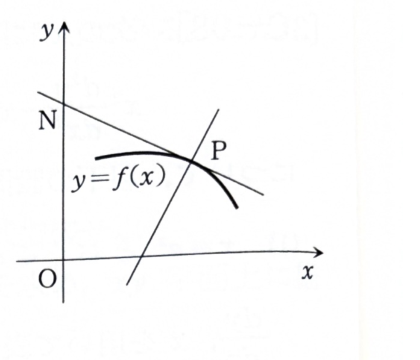

3C-11

曲線上の各点 $P$ における接線の接点 $P$ と $y$ 軸の間にある部分の長さ（線分 $NP$ の長さ）が、この接線の $y$ 軸切片（線分 $ON$ の長さ）に等しい曲線を考える。

---

## (1)

求める曲線を $y=f(x)$ とする。この曲線上の点 $P(x,y)$ における接線の方程式を求めよ。

---

## (1) 解答

> 点 $(x,y)$ を通り、傾きが $f'(x)$ の直線には点傾きの式を用いる。
>
> 接線上の一般点を $(X,Y)$ とし、曲線上の座標 $(x,y)$ と区別する。

点傾きの式は

$$
Y-y=m(X-x)
$$

である。接線の傾きは

$$
m=f'(x)
$$

だから、接線の方程式は

$$
\boxed{
Y-y=f'(x)(X-x)
}
$$

である。

---

## (2)

点 $N$ の座標を求めよ。

---

## (2) 解答

> 点 $N$ は接線と $y$ 軸の交点である。したがって接線の式へ $X=0$ を代入する。

接線の式は

$$
Y-y=f'(x)(X-x)
$$

である。$X=0$ を代入すると、

$$
Y-y=f'(x)(-x)
$$

だから、

$$
Y=-xf'(x)+y
$$

である。したがって、

$$
\boxed{
N=(0,-xf'(x)+y)
}
$$

となる。

---

## (3)

線分 $NP$ の長さと線分 $ON$ の長さが等しいことから、求める曲線が満足する微分方程式を求めよ。

---

## (3) 解答

> 座標から2つの長さを距離公式で表し、等式を2乗して平方根と絶対値を取り除く。
>
> 2乗により符号情報は失われるため、得られた曲線のうち、元の長さ・切片の条件を満たす部分を考える必要がある。

点は

$$
P=(x,y)
$$

および

$$
N=(0,-xf'(x)+y)
$$

である。距離公式から、

$$
NP
=
\sqrt{
(x-0)^2+
\{y-(-xf'(x)+y)\}^2
}
$$

となる。第2成分の差は

$$
y-(-xf'(x)+y)=xf'(x)
$$

だから、

$$
NP
=
\sqrt{x^2+x^2\{f'(x)\}^2}
$$

である。

一方、$N$ の $y$ 座標は $-xf'(x)+y$ なので、線分 $ON$ の長さは

$$
ON=|-xf'(x)+y|
$$

である。条件 $NP=ON$ より、

$$
\sqrt{x^2+x^2\{f'(x)\}^2}
=
|-xf'(x)+y|
$$

となる。両辺を2乗すると、

$$
x^2+x^2\{f'(x)\}^2
=
\{-xf'(x)+y\}^2
$$

である。右辺を展開して、

$$
x^2+x^2\{f'(x)\}^2
=
x^2\{f'(x)\}^2
-2xyf'(x)+y^2
$$

となる。共通項を消去すると、

$$
x^2=-2xyf'(x)+y^2
$$

だから、

$$
2xyf'(x)-y^2+x^2=0
$$

である。$f'(x)=dy/dx$ と書けば、

$$
\boxed{
2xy\frac{dy}{dx}-y^2+x^2=0
}
$$

を得る。

---

## (4)

(3) で求めた微分方程式は同次形である。変数の変換 $y=xz$ によって、$x$ と $z$ について変数分離形にせよ。

---

## (4) 解答

> $y=xz$ とおくと $y/x=z$ となり、同次形を変数分離形へ変換できる。
>
> $z$ は $x$ の関数なので、$y'$ には積の微分を用いる。

$$
y=xz
$$

とおくと、

$$
\frac{dy}{dx}
=
z+x\frac{dz}{dx}
$$

である。

(3) の方程式

$$
2xy\frac{dy}{dx}-y^2+x^2=0
$$

へ代入する前の文字式は

$$
2x(xz)\left(z+x\frac{dz}{dx}\right)
-(xz)^2+x^2=0
$$

である。展開すると、

$$
2x^2z^2
+
2x^3z\frac{dz}{dx}
-
x^2z^2
+x^2=0
$$

となる。$x^2$ をくくって、

$$
x^2
\left(
z^2+2xz\frac{dz}{dx}+1
\right)
=0
$$

である。$x\neq0$ として、

$$
z^2+2xz\frac{dz}{dx}+1=0
$$

となる。したがって、

$$
2xz\frac{dz}{dx}=-(z^2+1)
$$

である。変数を分離すると、

$$
\boxed{
\frac{2z}{z^2+1}\,dz
=
-\frac1x\,dx
}
$$

となる。

---

## (5)

(4) で求めた変数分離形微分方程式の解を求めよ。

---

## (5) 解答

> 両辺を積分する。左辺は $z^2+1$ の対数微分である。

(4) より、

$$
\frac{2z}{z^2+1}\,dz
=
-\frac1x\,dx
$$

である。両辺を積分すると、

$$
\int\frac{2z}{z^2+1}\,dz
=
-\int\frac1x\,dx
$$

となる。左辺は、

$$
u=z^2+1
$$

とおけば $du=2z\,dz$ なので、

$$
\log(z^2+1)
$$

である。したがって、

$$
\log(z^2+1)=-\log|x|+C
$$

となる。指数化し、任意定数を $A$ と書けば、

$$
\boxed{
z^2+1=\frac{A}{x}
}
$$

を得る。

---

## (6)

(5) で求めた解に $z=\dfrac{y}{x}$ を代入して、題意を満足する曲線を求めよ。

---

## (6) 解答

> $z=y/x$ を戻し、円の標準形へ平方完成する。

(5) の式は

$$
z^2+1=\frac{A}{x}
$$

である。$z=y/x$ を代入すると、

$$
\left(\frac{y}{x}\right)^2+1=\frac{A}{x}
$$

となる。両辺に $x^2$ を掛けて、

$$
y^2+x^2=Ax
$$

である。$x$ の項を平方完成すると、

$$
x^2-Ax+y^2=0
$$

だから、

$$
\left(x-\frac{A}{2}\right)^2+y^2
=
\left(\frac{A}{2}\right)^2
$$

となる。

したがって、求める曲線は

$$
\boxed{
\left(x-\frac{A}{2}\right)^2+y^2
=
\left(\frac{A}{2}\right)^2
}
$$

である。これは原点を通り、中心が $x$ 軸上にある円の族である。元の図の配置や切片の符号条件に応じて、題意を満たす円弧部分を選ぶ。
