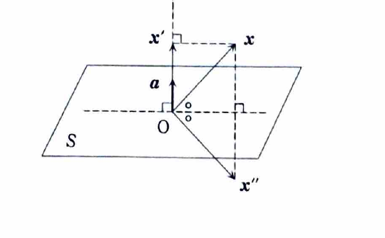
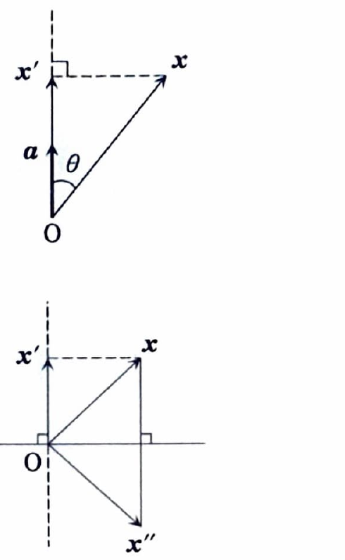

3次元空間において、原点 $O$ を通る平面 $S$ とベクトル $\boldsymbol{x}$ を考える。平面 $S$ の法線ベクトルは $\boldsymbol{a}\neq\boldsymbol{0}$ とする。また、$\boldsymbol{x}$ は原点 $O$ を始点とする任意のベクトルである。ベクトル $\boldsymbol{x},\boldsymbol{y}$ の内積を $\boldsymbol{x}\cdot\boldsymbol{y}$ と表す。

---

## (1)

$\boldsymbol{x}$ の $\boldsymbol{a}$ への正射影を $\boldsymbol{x}'$ とする。$\boldsymbol{x}'$ を $\boldsymbol{a},\boldsymbol{x}$ を用いて表せ。

---

## (1) 解答

> **この解法を選ぶ理由**
>
> $\boldsymbol{x}'$ は $\boldsymbol{a}$ と同じ方向にあるため、$\boldsymbol{x}'=c\boldsymbol{a}$ と表せる。
> 係数 $c$ は内積による射影公式から求める。
> 角度 $\theta$ を用いて長さから導く方法もあるが、内積公式の方が符号を含めて一般的に使える。
>
> **前提知識：ベクトルへの正射影**
>
> 非零ベクトル $\boldsymbol{a}$ の張る直線への $\boldsymbol{x}$ の正射影は
>
> $$
> \operatorname{proj}_{\boldsymbol{a}}\boldsymbol{x}
> =
> \frac{\boldsymbol{a}\cdot\boldsymbol{x}}
> {\boldsymbol{a}\cdot\boldsymbol{a}}
> \boldsymbol{a}
> $$
>
> である。また
>
> $$
> \boldsymbol{a}\cdot\boldsymbol{a}
> =
> \lVert\boldsymbol{a}\rVert^2.
> $$

$\boldsymbol{x}'$ は $\boldsymbol{a}$ に平行なので、ある実数 $c$ を用いて

$$
\boldsymbol{x}'=c\boldsymbol{a}
$$

と書ける。

正射影の条件から、残差

$$
\boldsymbol{x}-\boldsymbol{x}'
$$

は $\boldsymbol{a}$ に直交する。したがって

$$
\boldsymbol{a}\cdot(\boldsymbol{x}-\boldsymbol{x}')=0.
$$

内積の分配法則を使うと

$$
\boldsymbol{a}\cdot\boldsymbol{x}
-
\boldsymbol{a}\cdot\boldsymbol{x}'
=
0.
$$

$\boldsymbol{x}'=c\boldsymbol{a}$ を代入する前の式は

$$
\boldsymbol{a}\cdot\boldsymbol{x}
-
\boldsymbol{a}\cdot(c\boldsymbol{a})
=
0.
$$

代入して整理すると

$$
\boldsymbol{a}\cdot\boldsymbol{x}
-
c(\boldsymbol{a}\cdot\boldsymbol{a})
=
0.
$$

したがって

$$
c
=
\frac{\boldsymbol{a}\cdot\boldsymbol{x}}
{\boldsymbol{a}\cdot\boldsymbol{a}}
=
\frac{\boldsymbol{a}\cdot\boldsymbol{x}}
{\lVert\boldsymbol{a}\rVert^2}.
$$

これを $\boldsymbol{x}'=c\boldsymbol{a}$ へ代入して

$$
\boxed{
\boldsymbol{x}'
=
\frac{\boldsymbol{a}\cdot\boldsymbol{x}}
{\lVert\boldsymbol{a}\rVert^2}
\boldsymbol{a}
}
$$

を得る。

---

## (2)

$\boldsymbol{x}$ の平面 $S$ に関する折り返しを表すベクトルを $\boldsymbol{x}''$ とする。$\boldsymbol{x}''$ を $\boldsymbol{a},\boldsymbol{x}$ を用いて表せ。

---

## (2) 解答

> **この解法を選ぶ理由**
>
> 平面に関する折り返しでは、平面に平行な成分はそのままで、法線方向の成分だけ符号が反転する。
> $\boldsymbol{x}$ の法線方向成分が (1) の $\boldsymbol{x}'$ なので、元のベクトルからその成分を2回引けばよい。
> 平面方向成分と法線方向成分へ分解して説明する方法も同じ内容である。

$\boldsymbol{x}$ を、平面に平行な成分 $\boldsymbol{x}_S$ と法線方向成分 $\boldsymbol{x}'$ に分けると

$$
\boldsymbol{x}
=
\boldsymbol{x}_S+\boldsymbol{x}'.
$$

折り返し後は平面方向成分が同じで、法線方向成分が $-\boldsymbol{x}'$ になるため

$$
\boldsymbol{x}''
=
\boldsymbol{x}_S-\boldsymbol{x}'.
$$

一方、元の式から

$$
\boldsymbol{x}_S
=
\boldsymbol{x}-\boldsymbol{x}'.
$$

これを代入する前の式は

$$
\boldsymbol{x}''
=
\boldsymbol{x}_S-\boldsymbol{x}'.
$$

値を代入すると

$$
\boldsymbol{x}''
=
(\boldsymbol{x}-\boldsymbol{x}')-\boldsymbol{x}'
=
\boldsymbol{x}-2\boldsymbol{x}'.
$$

(1)の結果

$$
\boldsymbol{x}'
=
\frac{\boldsymbol{a}\cdot\boldsymbol{x}}
{\lVert\boldsymbol{a}\rVert^2}
\boldsymbol{a}
$$

を代入して

$$
\boxed{
\boldsymbol{x}''
=
\boldsymbol{x}
-
2
\frac{\boldsymbol{a}\cdot\boldsymbol{x}}
{\lVert\boldsymbol{a}\rVert^2}
\boldsymbol{a}
}
$$

を得る。

---

## (3)

(2)において、$\boldsymbol{x}$ に $\boldsymbol{x}''$ を対応させる写像は線形写像である。いま、

$$
\boldsymbol{a}=
\begin{pmatrix}
1\\1\\1
\end{pmatrix},
\qquad
\boldsymbol{x}=
\begin{pmatrix}
x\\y\\z
\end{pmatrix},
\qquad
\boldsymbol{x}''=
\begin{pmatrix}
x''\\y''\\z''
\end{pmatrix}
$$

とおく。この線形写像を表す行列を求めよ。

---

## (3) 解答

> **この解法を選ぶ理由**
>
> (2)の一般公式へ $\boldsymbol{a}=(1,1,1)^{\mathsf T}$ を代入し、$x,y,z$ の係数を整理すれば表現行列が得られる。
> 標準基底3本の像を個別に計算する方法もあるが、一般式を使う方が一度で求められる。

(2)の文字式は

$$
\boldsymbol{x}''
=
\boldsymbol{x}
-
2
\frac{\boldsymbol{a}\cdot\boldsymbol{x}}
{\lVert\boldsymbol{a}\rVert^2}
\boldsymbol{a}.
$$

まず内積を計算する前の式は

$$
\boldsymbol{a}\cdot\boldsymbol{x}
=
\begin{pmatrix}
1\\1\\1
\end{pmatrix}
\cdot
\begin{pmatrix}
x\\y\\z
\end{pmatrix}.
$$

値を計算すると

$$
\boldsymbol{a}\cdot\boldsymbol{x}
=
x+y+z.
$$

また、

$$
\lVert\boldsymbol{a}\rVert^2
=
\boldsymbol{a}\cdot\boldsymbol{a}
$$

に値を代入すると

$$
\lVert\boldsymbol{a}\rVert^2
=
1^2+1^2+1^2
=
3.
$$

したがって、

$$
\begin{aligned}
\boldsymbol{x}''
&=
\begin{pmatrix}
x\\y\\z
\end{pmatrix}
-
2\frac{x+y+z}{3}
\begin{pmatrix}
1\\1\\1
\end{pmatrix}\\
&=
\frac13
\left\{
\begin{pmatrix}
3x\\3y\\3z
\end{pmatrix}
-
2
\begin{pmatrix}
x+y+z\\x+y+z\\x+y+z
\end{pmatrix}
\right\}\\
&=
\frac13
\begin{pmatrix}
x-2y-2z\\
-2x+y-2z\\
-2x-2y+z
\end{pmatrix}.
\end{aligned}
$$

これを行列積の形にすると

$$
\begin{pmatrix}
x''\\y''\\z''
\end{pmatrix}
=
\frac13
\begin{pmatrix}
1&-2&-2\\
-2&1&-2\\
-2&-2&1
\end{pmatrix}
\begin{pmatrix}
x\\y\\z
\end{pmatrix}.
$$

したがって、求める行列は

$$
\boxed{
\frac13
\begin{pmatrix}
1&-2&-2\\
-2&1&-2\\
-2&-2&1
\end{pmatrix}
}
$$

である。

> この行列を $R$ とすると、折り返しを2回行えば元に戻るため
>
> $$
> R^2=E
> $$
>
> が成り立つ。また法線方向では固有値 $-1$、平面方向では固有値 $1$ になる。
