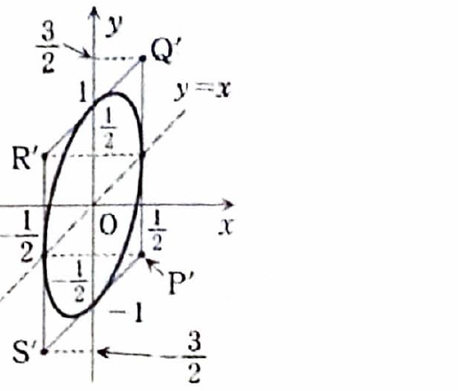
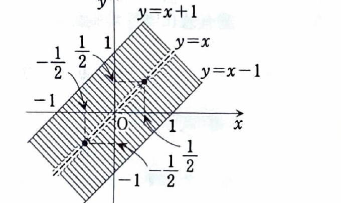

行列

$$
\begin{pmatrix}
1-t&t\\
-t&1+t
\end{pmatrix}
$$

が表す平面上の1次変換を $f$ とする。点

$$
P=(1,0),\quad
Q=(0,1),\quad
R=(-1,0),\quad
S=(0,-1)
$$

を考える。さらに円

$$
C:x^2+y^2=\frac12
$$

とし、円 $C$ が $f$ によって移される図形を $C'$ とする。

---

## (1)

$t=\dfrac12$ のとき、$f$ によって四角形 $PQRS$ はどのような図形に移されるか。

---

## (1) 解答

> **この解法を選ぶ理由**
>
> 四角形の各頂点に変換行列を掛け、像の頂点を求める。
> 線形変換は線分を線分へ写すため、4頂点の像を順に結べば変換後の四角形が決まる。
> 辺ベクトルだけを変換する方法もあるが、位置関係を明確にするため頂点を直接計算する。

$t=\dfrac12$ を代入する前の行列は

$$
F_t=
\begin{pmatrix}
1-t&t\\
-t&1+t
\end{pmatrix}.
$$

値を代入すると

$$
F_{\frac12}
=
\begin{pmatrix}
\frac12&\frac12\\
-\frac12&\frac32
\end{pmatrix}
=
\frac12
\begin{pmatrix}
1&1\\
-1&3
\end{pmatrix}.
$$

点 $P=(1,0)$ の像を求める。文字式は

$$
P'=F_{\frac12}P
$$

である。値を代入すると

$$
P'
=
\frac12
\begin{pmatrix}
1&1\\
-1&3
\end{pmatrix}
\begin{pmatrix}
1\\0
\end{pmatrix}
=
\frac12
\begin{pmatrix}
1\\-1
\end{pmatrix}
=
\left(\frac12,-\frac12\right).
$$

同様に、

$$
Q'=F_{\frac12}Q
=
\frac12
\begin{pmatrix}
1&1\\
-1&3
\end{pmatrix}
\begin{pmatrix}
0\\1
\end{pmatrix}
=
\frac12
\begin{pmatrix}
1\\3
\end{pmatrix}
=
\left(\frac12,\frac32\right),
$$

$$
R'=F_{\frac12}R
=
\frac12
\begin{pmatrix}
1&1\\
-1&3
\end{pmatrix}
\begin{pmatrix}
-1\\0
\end{pmatrix}
=
\frac12
\begin{pmatrix}
-1\\1
\end{pmatrix}
=
\left(-\frac12,\frac12\right),
$$

$$
S'=F_{\frac12}S
=
\frac12
\begin{pmatrix}
1&1\\
-1&3
\end{pmatrix}
\begin{pmatrix}
0\\-1
\end{pmatrix}
=
\frac12
\begin{pmatrix}
-1\\-3
\end{pmatrix}
=
\left(-\frac12,-\frac32\right).
$$

したがって、四角形 $PQRS$ は頂点

$$
\boxed{
P'\left(\frac12,-\frac12\right),\quad
Q'\left(\frac12,\frac32\right),\quad
R'\left(-\frac12,\frac12\right),\quad
S'\left(-\frac12,-\frac32\right)
}
$$

を持つ平行四辺形 $P'Q'R'S'$ に移される。

> 対角線の中点はいずれも原点であり、線形変換が原点対称性を保っていることも確認できる。

---

## (2)

(1)で求めた図形との位置関係に注意して、$t=\dfrac12$ のときの図形 $C'$ の概形を描け。

---

## (2) 解答

> **この解法を選ぶ理由**
>
> 円 $C$ を三角関数で媒介変数表示し、変換後の座標から媒介変数を消去して2次曲線の方程式を求める。
> その方程式と (1) の頂点を使えば、楕円の位置と向きを正確に描ける。
> 逆行列で元の円の方程式へ代入する方法もあるが、資料の解答に沿って媒介変数を用いる。
>
> **前提知識**
>
> 円
>
> $$
> x_0^2+y_0^2=\frac12
> $$
>
> 上の点は
>
> $$
> \begin{pmatrix}
> x_0\\y_0
> \end{pmatrix}
> =
> \frac1{\sqrt2}
> \begin{pmatrix}
> \cos\theta\\\sin\theta
> \end{pmatrix}
> $$
>
> と表せる。

円 $C$ 上の点を

$$
\begin{pmatrix}
x_0\\y_0
\end{pmatrix}
=
\frac1{\sqrt2}
\begin{pmatrix}
\cos\theta\\\sin\theta
\end{pmatrix}
$$

とする。像の点を $(x,y)$ とすると

$$
\begin{pmatrix}
x\\y
\end{pmatrix}
=
F_{\frac12}
\begin{pmatrix}
x_0\\y_0
\end{pmatrix}.
$$

値を代入すると

$$
\begin{aligned}
\begin{pmatrix}
x\\y
\end{pmatrix}
&=
\frac12
\begin{pmatrix}
1&1\\
-1&3
\end{pmatrix}
\frac1{\sqrt2}
\begin{pmatrix}
\cos\theta\\\sin\theta
\end{pmatrix}\\
&=
\frac1{2\sqrt2}
\begin{pmatrix}
\cos\theta+\sin\theta\\
-\cos\theta+3\sin\theta
\end{pmatrix}.
\end{aligned}
$$

したがって

$$
x=\frac{\cos\theta+\sin\theta}{2\sqrt2},
\qquad
y=\frac{-\cos\theta+3\sin\theta}{2\sqrt2}.
$$

$\sin\theta,\cos\theta$ を取り出すため、まず

$$
x+y
$$

を計算する。値を代入すると

$$
x+y
=
\frac{(\cos\theta+\sin\theta)+(-\cos\theta+3\sin\theta)}
{2\sqrt2}
=
\sqrt2\sin\theta.
$$

次に

$$
3x-y
$$

を計算すると

$$
3x-y
=
\frac{3(\cos\theta+\sin\theta)-(-\cos\theta+3\sin\theta)}
{2\sqrt2}
=
\sqrt2\cos\theta.
$$

したがって、

$$
x+y=\sqrt2\sin\theta,
\qquad
3x-y=\sqrt2\cos\theta.
$$

両式を二乗して加えると

$$
(x+y)^2+(3x-y)^2
=
2(\sin^2\theta+\cos^2\theta)
=
2.
$$

展開すると

$$
x^2+2xy+y^2+9x^2-6xy+y^2=2,
$$

$$
10x^2-4xy+2y^2=2.
$$

両辺を2で割って

$$
\boxed{5x^2-2xy+y^2=1}
$$

を得る。

これは楕円である。さらに、(1)の各頂点と楕円の位置関係を描くと次の概形になる。

---

## (3)

$t$ がすべての実数を動くとき、$C'$ が通過し得る点 $(x,y)$ の集合を求めよ。

---

## (3) 解答

> **この解法を選ぶ理由**
>
> 任意の $t$ に対する像の点 $(x,y)$ を、円の媒介変数 $\theta$ と $t$ で表す。
> $\sin\theta,\cos\theta$ を $x,y,t$ で表し、
>
> $$
> \sin^2\theta+\cos^2\theta=1
> $$
>
> を使うと、$t$ に関する2次方程式が得られる。
> 与えられた $(x,y)$ に対して実数 $t$ が存在する条件を判別式で調べる。
> 各 $t$ の楕円方程式を作って合併を考える方法もあるが、同じ判別式に帰着する。

円 $C$ 上の点を

$$
\frac1{\sqrt2}
\begin{pmatrix}
\cos\theta\\\sin\theta
\end{pmatrix}
$$

とする。一般の $t$ に対する像は

$$
\begin{aligned}
\begin{pmatrix}
x\\y
\end{pmatrix}
&=
\begin{pmatrix}
1-t&t\\
-t&1+t
\end{pmatrix}
\frac1{\sqrt2}
\begin{pmatrix}
\cos\theta\\\sin\theta
\end{pmatrix}\\
&=
\frac1{\sqrt2}
\begin{pmatrix}
(1-t)\cos\theta+t\sin\theta\\
-t\cos\theta+(1+t)\sin\theta
\end{pmatrix}.
\end{aligned}
$$

したがって

$$
\sqrt2x=(1-t)\cos\theta+t\sin\theta,
\tag{1}
$$

$$
\sqrt2y=-t\cos\theta+(1+t)\sin\theta.
\tag{2}
$$

$\sin\theta$ を取り出すため、(1)を $t$ 倍し、(2)を $1-t$ 倍して加える。左辺は

$$
\sqrt2\{tx+(1-t)y\}
$$

である。右辺では $\cos\theta$ の係数が

$$
t(1-t)-(1-t)t=0
$$

となり、$\sin\theta$ の係数は

$$
t^2+(1-t)(1+t)
=
t^2+1-t^2
=
1
$$

となる。したがって、

$$
tx+(1-t)y
=
\frac1{\sqrt2}\sin\theta.
\tag{3}
$$

同様に、(1)を $1+t$ 倍し、(2)を $-t$ 倍して加えると

$$
(1+t)x-ty
=
\frac1{\sqrt2}\cos\theta.
\tag{4}
$$

(3),(4)を二乗して加え、

$$
\sin^2\theta+\cos^2\theta=1
$$

を使うと

$$
\{tx+(1-t)y\}^2
+
\{(1+t)x-ty\}^2
=
\frac12.
$$

これを $t$ について整理する。まず

$$
tx+(1-t)y
=
y+t(x-y),
$$

$$
(1+t)x-ty
=
x+t(x-y).
$$

したがって、

$$
\{y+t(x-y)\}^2+\{x+t(x-y)\}^2=\frac12.
$$

展開すると

$$
2(x-y)^2t^2
+
2(x-y)(x+y)t
+
x^2+y^2-\frac12
=
0.
$$

両辺を2倍して資料の形にすると

$$
4(x-y)^2t^2
+
4(x^2-y^2)t
+
2x^2+2y^2-1
=
0.
\tag{5}
$$

固定した点 $(x,y)$ がどれかの $C'$ 上にあるためには、(5)が実数解 $t$ を持てばよい。

### $x=y$ の場合

$x-y=0$ なので、(5)は

$$
4x^2-1=0
$$

となる。したがって

$$
x=y=\frac12
$$

または

$$
x=y=-\frac12
$$

のときだけ実数 $t$ が存在する。

### $x\neq y$ の場合

(5)は $t$ の2次方程式である。係数を

$$
A=4(x-y)^2,
\quad
B=4(x^2-y^2),
\quad
C=2x^2+2y^2-1
$$

とする。実数解を持つ条件は

$$
D=B^2-4AC\ge0
$$

である。

値を代入すると

$$
\begin{aligned}
D
&=
16(x^2-y^2)^2
-
16(x-y)^2(2x^2+2y^2-1)\\
&=
16(x-y)^2
\left\{
(x+y)^2-(2x^2+2y^2-1)
\right\}\\
&=
16(x-y)^2
\left\{
1-(x-y)^2
\right\}.
\end{aligned}
$$

$x\neq y$ では $(x-y)^2>0$ なので、

$$
D\ge0
$$

は

$$
1-(x-y)^2\ge0
$$

と同値である。したがって

$$
(x-y)^2\le1,
$$

すなわち

$$
-1\le x-y\le1.
$$

$y$ について書けば

$$
x-1\le y\le x+1.
$$

ただし、$x=y$ の直線上では、先ほど示した2点

$$
\left(\frac12,\frac12\right),
\qquad
\left(-\frac12,-\frac12\right)
$$

だけが含まれ、それ以外は除く。

よって、求める集合は

$$
\boxed{
\left\{
(x,y)\mid x-1\le y\le x+1
\right\}
\setminus
\left\{
(x,x)\mid x\neq\pm\frac12
\right\}
}
$$

である。

