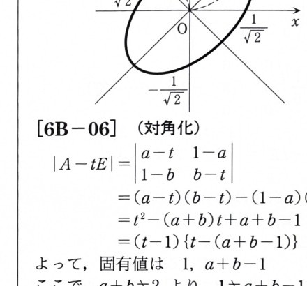

問題 6B-05

2次形式

$$
f(x,y)=2x^2-2xy+2y^2
$$

について、次の問いに答えよ。

---

## (1)

\(f(x,y)\) を、2次の実対称行列 \(A\) とベクトル

$$
\boldsymbol{x}=
\begin{pmatrix}
x\\y
\end{pmatrix}
$$

を用いて

$$
f(x,y)={}^t\boldsymbol{x}A\boldsymbol{x}
$$

と書くとき、\(A\) を求めよ。

---

## (1) 解答

> **解法を選ぶ理由**
>
> 対称行列
>
> $$
> A=
> \begin{pmatrix}
> a&b\\
> b&c
> \end{pmatrix}
> $$
>
> に対して二次形式を展開し、\(x^2,xy,y^2\) の係数を比較する。
> 非対角成分 \(b\) は交差項に2回現れる点に注意する。

まず文字のまま展開する。

$$
{}^t\boldsymbol{x}A\boldsymbol{x}
=
\begin{pmatrix}
x&y
\end{pmatrix}
\begin{pmatrix}
a&b\\
b&c
\end{pmatrix}
\begin{pmatrix}
x\\y
\end{pmatrix}
$$

である。中央の行列と列ベクトルを掛けると、

$$
\begin{pmatrix}
a&b\\
b&c
\end{pmatrix}
\begin{pmatrix}
x\\y
\end{pmatrix}
=
\begin{pmatrix}
ax+by\\
bx+cy
\end{pmatrix}
$$

なので、

$$
{}^t\boldsymbol{x}A\boldsymbol{x}
=x(ax+by)+y(bx+cy)
$$

$$
=ax^2+2bxy+cy^2
$$

である。これを

$$
2x^2-2xy+2y^2
$$

と係数比較すると、

$$
a=2
$$

$$
2b=-2
$$

$$
c=2
$$

である。したがって、

$$
b=-1
$$

であり、

$$
\boxed{
A=
\begin{pmatrix}
2&-1\\
-1&2
\end{pmatrix}
}
$$

である。

---

## (2)

\(A\) の固有値と固有ベクトルを求めよ。次に、2次曲線 \(f(x,y)=1\) を、
固有ベクトルの方向を新しい座標軸とする座標系 \(O-XY\) で表し、その概形を示せ。

---

## (2) 解答

> **解法を選ぶ理由**
>
> 実対称行列を直交対角化すると、二次形式の交差項を消せる。
> まず固有値・固有ベクトルを求め、単位固有ベクトルを新しい座標軸に選ぶ。
> 平方完成でも交差項を消せるが、問題が固有ベクトルの方向を指定しているため、
> 直交対角化を用いる。

固有方程式は、

$$
\det(A-\lambda E)=0
$$

である。まず、

$$
A-\lambda E=
\begin{pmatrix}
2-\lambda&-1\\
-1&2-\lambda
\end{pmatrix}
$$

なので、

$$
\begin{aligned}
\det(A-\lambda E)
&=(2-\lambda)^2-1\\
&=\lambda^2-4\lambda+3\\
&=(\lambda-1)(\lambda-3)
\end{aligned}
$$

である。したがって、

$$
\boxed{\lambda=1,\qquad3}
$$

である。

### 固有値 \(\lambda=1\)

$$
A-E=
\begin{pmatrix}
1&-1\\
-1&1
\end{pmatrix}
$$

より、

$$
x-y=0
$$

なので、

$$
x=y
$$

である。固有ベクトルは、

$$
v=s
\begin{pmatrix}
1\\1
\end{pmatrix}
\qquad(s\ne0)
$$

である。単位固有ベクトルを

$$
e_X=
\frac1{\sqrt2}
\begin{pmatrix}
1\\1
\end{pmatrix}
$$

とする。

### 固有値 \(\lambda=3\)

$$
A-3E=
\begin{pmatrix}
-1&-1\\
-1&-1
\end{pmatrix}
$$

より、

$$
x+y=0
$$

なので、

$$
x=-y
$$

である。固有ベクトルは、

$$
v=t
\begin{pmatrix}
-1\\1
\end{pmatrix}
\qquad(t\ne0)
$$

である。単位固有ベクトルを

$$
e_Y=
\frac1{\sqrt2}
\begin{pmatrix}
-1\\1
\end{pmatrix}
$$

とする。

新しい座標 \(X,Y\) を使うと、位置ベクトルは、

$$
\begin{pmatrix}
x\\y
\end{pmatrix}
=
X e_X+Y e_Y
$$

である。値を代入する前の式を示すと、

$$
\begin{pmatrix}
x\\y
\end{pmatrix}
=
X\frac1{\sqrt2}
\begin{pmatrix}
1\\1
\end{pmatrix}
+
Y\frac1{\sqrt2}
\begin{pmatrix}
-1\\1
\end{pmatrix}
$$

である。成分を比較すると、

$$
x=\frac{X-Y}{\sqrt2}
$$

$$
y=\frac{X+Y}{\sqrt2}
$$

となる。

元の方程式は、

$$
2x^2-2xy+2y^2=1
$$

である。ここへ代入する前の変換式

$$
x=\frac{X-Y}{\sqrt2},
\qquad
y=\frac{X+Y}{\sqrt2}
$$

を代入すると、

$$
2\left(\frac{X-Y}{\sqrt2}\right)^2
-2\left(\frac{X-Y}{\sqrt2}\right)
\left(\frac{X+Y}{\sqrt2}\right)
+2\left(\frac{X+Y}{\sqrt2}\right)^2
=1
$$

となる。分母を整理すると、

$$
(X-Y)^2-(X-Y)(X+Y)+(X+Y)^2=1
$$

である。各項を展開すると、

$$
X^2-2XY+Y^2-(X^2-Y^2)+X^2+2XY+Y^2=1
$$

であり、交差項が消えて、

$$
X^2+3Y^2=1
$$

を得る。標準形にすると、

$$
\boxed{
\frac{X^2}{1^2}
+
\frac{Y^2}{(1/\sqrt3)^2}
=1
}
$$

である。

したがって、中心は原点、\(X\) 軸方向の半径は \(1\)、\(Y\) 軸方向の半径は
\(1/\sqrt3\) の楕円である。元の \(xy\) 座標では、長軸 \(X\) は直線 \(y=x\) の方向、
短軸 \(Y\) は直線 \(y=-x\) の方向である。

