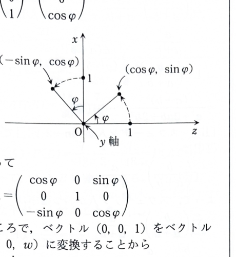

問題 6C-12

空間において、\(xz\) 平面上の単位ベクトル

$$
\begin{pmatrix}
u\\0\\w
\end{pmatrix}
$$

を考える。単位ベクトルであるから、

$$
u^2+w^2=1
$$

である。

---

## (1)

\(y\) 軸まわりの回転を表す行列のうち、ベクトル

$$
\begin{pmatrix}
0\\0\\1
\end{pmatrix}
$$

を

$$
\begin{pmatrix}
u\\0\\w
\end{pmatrix}
$$

へ移す行列 \(A\) を求めよ。

---

## (1) 解答

> **解法を選ぶ理由**
>
> \(y\) 軸まわりの回転では \(y\) 成分は変化せず、
> \(xz\) 平面内だけが回転する。
> 一般の回転角を \(\varphi\) として回転行列を書き、
> 指定されたベクトルの像と成分比較する。
>
> 幾何的には、\(z\) 軸の正方向を回転軸候補
> \((u,0,w)^T\) に重ねる操作である。

\(y\) 軸まわりに角 \(\varphi\) だけ回転する行列を、

$$
A=
\begin{pmatrix}
\cos\varphi&0&\sin\varphi\\
0&1&0\\
-\sin\varphi&0&\cos\varphi
\end{pmatrix}
$$

とする。

値を代入する前に、この行列を \(z\) 軸方向の単位ベクトルへ作用させると、

$$
A
\begin{pmatrix}
0\\0\\1
\end{pmatrix}
=
\begin{pmatrix}
\sin\varphi\\
0\\
\cos\varphi
\end{pmatrix}
$$

である。

これが、

$$
\begin{pmatrix}
u\\0\\w
\end{pmatrix}
$$

に等しいため、成分を比較して、

$$
\sin\varphi=u
$$

$$
\cos\varphi=w
$$

を得る。この2式は、\(u^2+w^2=1\) であるため同時に満たせる。

したがって、\(\sin\varphi=u\)、\(\cos\varphi=w\) を一般式へ代入すると、

$$
\boxed{
A=
\begin{pmatrix}
w&0&u\\
0&1&0\\
-u&0&w
\end{pmatrix}
}
$$

である。

実際、

$$
\begin{pmatrix}
w&0&u\\
0&1&0\\
-u&0&w
\end{pmatrix}
\begin{pmatrix}
0\\0\\1
\end{pmatrix}
=
\begin{pmatrix}
u\\0\\w
\end{pmatrix}
$$

となる。

---

## (2)

(1)で求めた行列を利用して、ベクトル

$$
\begin{pmatrix}
u\\0\\w
\end{pmatrix}
$$

を軸とする角度 \(\theta\) の回転を表す行列を求めよ。

---

## (2) 解答

> **解法を選ぶ理由**
>
> 任意方向の軸まわりの回転は、
>
> 1. 回転軸を標準的な \(z\) 軸へ移す  
> 2. \(z\) 軸まわりに角 \(\theta\) だけ回す  
> 3. 軸を元の位置へ戻す
>
> という3段階に分解できる。
> (1)の行列 \(A\) は \(z\) 軸を \((u,0,w)^T\) へ移すので、
> 逆行列 \(A^{-1}\) は \((u,0,w)^T\) を \(z\) 軸へ移す。
> したがって、求める行列は \(ABA^{-1}\) となる。
>
> ロドリゲスの回転公式を直接用いる別解もあるが、
> 問題の指示に沿って座標軸を合わせる方法を用いる。

\(z\) 軸まわりに角 \(\theta\) だけ回転する行列を、

$$
B=
\begin{pmatrix}
\cos\theta&-\sin\theta&0\\
\sin\theta&\cos\theta&0\\
0&0&1
\end{pmatrix}
$$

とする。

(1)で求めた \(A\) は回転行列なので直交行列であり、

$$
A^{-1}=A^T
$$

である。したがって、

$$
A^{-1}
=
\begin{pmatrix}
w&0&-u\\
0&1&0\\
u&0&w
\end{pmatrix}.
$$

求める変換の順序は、列ベクトルに右側から作用する順に、

$$
A^{-1}
\longrightarrow
B
\longrightarrow
A
$$

である。よって、求める行列を \(C\) とすると、

$$
C=ABA^{-1}
$$

である。

まず、値を代入する前の積は、

$$
BA^{-1}
=
\begin{pmatrix}
\cos\theta&-\sin\theta&0\\
\sin\theta&\cos\theta&0\\
0&0&1
\end{pmatrix}
\begin{pmatrix}
w&0&-u\\
0&1&0\\
u&0&w
\end{pmatrix}.
$$

行列積を成分ごとに計算すると、

$$
BA^{-1}
=
\begin{pmatrix}
w\cos\theta&-\sin\theta&-u\cos\theta\\
w\sin\theta&\cos\theta&-u\sin\theta\\
u&0&w
\end{pmatrix}.
$$

次に、

$$
C
=
A(BA^{-1})
$$

へ代入すると、

$$
C
=
\begin{pmatrix}
w&0&u\\
0&1&0\\
-u&0&w
\end{pmatrix}
\begin{pmatrix}
w\cos\theta&-\sin\theta&-u\cos\theta\\
w\sin\theta&\cos\theta&-u\sin\theta\\
u&0&w
\end{pmatrix}.
$$

各成分を順に計算する。

第1行は、

$$
\begin{aligned}
C_{11}&=w\cdot w\cos\theta+0\cdot w\sin\theta+u\cdot u
=w^2\cos\theta+u^2,\\
C_{12}&=w(-\sin\theta)+0\cdot\cos\theta+u\cdot0
=-w\sin\theta,\\
C_{13}&=w(-u\cos\theta)+0(-u\sin\theta)+u\cdot w
=uw(1-\cos\theta).
\end{aligned}
$$

第2行は、

$$
\begin{aligned}
C_{21}&=0\cdot w\cos\theta+1\cdot w\sin\theta+0\cdot u
=w\sin\theta,\\
C_{22}&=0(-\sin\theta)+1\cdot\cos\theta+0\cdot0
=\cos\theta,\\
C_{23}&=0(-u\cos\theta)+1(-u\sin\theta)+0\cdot w
=-u\sin\theta.
\end{aligned}
$$

第3行は、

$$
\begin{aligned}
C_{31}&=(-u)w\cos\theta+0\cdot w\sin\theta+w\cdot u
=uw(1-\cos\theta),\\
C_{32}&=(-u)(-\sin\theta)+0\cdot\cos\theta+w\cdot0
=u\sin\theta,\\
C_{33}&=(-u)(-u\cos\theta)+0(-u\sin\theta)+w\cdot w
=u^2\cos\theta+w^2.
\end{aligned}
$$

したがって、求める回転行列は、

$$
\boxed{
C=
\begin{pmatrix}
w^2\cos\theta+u^2
&
-w\sin\theta
&
uw(1-\cos\theta)
\\
w\sin\theta
&
\cos\theta
&
-u\sin\theta
\\
uw(1-\cos\theta)
&
u\sin\theta
&
u^2\cos\theta+w^2
\end{pmatrix}
}
$$

である。

---

## (3)

(2)で求めた行列の実数の固有値と固有ベクトルを求めよ。

---

## (3) 解答

> **解法を選ぶ理由**
>
> 回転軸上のベクトルは回転しても変化しないため、
> 軸方向のベクトルは固有値 \(1\) の固有ベクトルである。
> 3次の特性多項式を直接展開する方法もあるが、
> 回転の幾何学的意味と、\(C=ABA^{-1}\) が相似変換であることを使う方が明確である。
>
> 資料の解答では、一般の回転角について実固有値 \(1\) と
> その軸方向の固有ベクトルを答えている。
> ただし、\(\theta\) が \(0\) または \(\pi\) の整数倍に一致する場合には
> 追加の実固有値・固有ベクトルが生じるため、最後に場合分けして補足する。

まず、回転軸の方向ベクトルを、

$$
v=
\begin{pmatrix}
u\\0\\w
\end{pmatrix}
$$

とする。

(2)で得た行列 \(C\) を作用させる。値を代入する前の積は、

$$
Cv=
\begin{pmatrix}
w^2\cos\theta+u^2
&
-w\sin\theta
&
uw(1-\cos\theta)
\\
w\sin\theta
&
\cos\theta
&
-u\sin\theta
\\
uw(1-\cos\theta)
&
u\sin\theta
&
u^2\cos\theta+w^2
\end{pmatrix}
\begin{pmatrix}
u\\0\\w
\end{pmatrix}.
$$

第1成分は、

$$
\begin{aligned}
&(w^2\cos\theta+u^2)u
+(-w\sin\theta)\cdot0
+uw(1-\cos\theta)w\\
&=uw^2\cos\theta+u^3+uw^2-uw^2\cos\theta\\
&=u(u^2+w^2)\\
&=u
\end{aligned}
$$

である。最後に \(u^2+w^2=1\) を用いた。

第2成分は、

$$
w\sin\theta\cdot u
+\cos\theta\cdot0
-u\sin\theta\cdot w
=uw\sin\theta-uw\sin\theta
=0
$$

である。

第3成分は、

$$
\begin{aligned}
&uw(1-\cos\theta)u
+u\sin\theta\cdot0
+(u^2\cos\theta+w^2)w\\
&=u^2w-u^2w\cos\theta+u^2w\cos\theta+w^3\\
&=w(u^2+w^2)\\
&=w
\end{aligned}
$$

である。

したがって、

$$
C
\begin{pmatrix}
u\\0\\w
\end{pmatrix}
=
\begin{pmatrix}
u\\0\\w
\end{pmatrix}
=
1
\begin{pmatrix}
u\\0\\w
\end{pmatrix}.
$$

よって、固有値 \(1\) に対する固有ベクトルは、

$$
\boxed{
k
\begin{pmatrix}
u\\0\\w
\end{pmatrix}
\qquad(k\ne0)
}
$$

である。

さらに、\(C=ABA^{-1}\) であるから、\(C\) と \(B\) は相似であり、
同じ固有値をもつ。\(B\) は \(z\) 軸まわりの回転行列なので、その特性多項式は、

$$
\det(B-\lambda E)
=
(1-\lambda)
\det
\begin{pmatrix}
\cos\theta-\lambda&-\sin\theta\\
\sin\theta&\cos\theta-\lambda
\end{pmatrix}.
$$

2次部分を計算すると、

$$
\begin{aligned}
&(\cos\theta-\lambda)^2
-(-\sin\theta)(\sin\theta)\\
&=(\cos\theta-\lambda)^2+\sin^2\theta\\
&=\lambda^2-2\lambda\cos\theta+\cos^2\theta+\sin^2\theta\\
&=\lambda^2-2\lambda\cos\theta+1.
\end{aligned}
$$

したがって、

$$
\det(B-\lambda E)
=
(1-\lambda)
(\lambda^2-2\lambda\cos\theta+1).
$$

2次方程式

$$
\lambda^2-2\lambda\cos\theta+1=0
$$

の判別式は、

$$
D=(-2\cos\theta)^2-4
=4(\cos^2\theta-1)
=-4\sin^2\theta
$$

である。

### \(\sin\theta\ne0\) の場合

判別式は負なので、2次部分から実固有値は得られない。
したがって、実固有値は \(1\) だけである。

$$
\boxed{
\lambda=1,\qquad
v=k
\begin{pmatrix}
u\\0\\w
\end{pmatrix}
\ (k\ne0)
}
$$

### \(\theta\equiv0\pmod{2\pi}\) の場合

このとき回転は恒等変換であり、

$$
C=E
$$

である。したがって、実固有値は \(1\) だけであるが、
すべての非零ベクトルが固有ベクトルとなる。

$$
\boxed{
\lambda=1,\qquad
v\in\mathbb{R}^3,\ v\ne0
}
$$

### \(\theta\equiv\pi\pmod{2\pi}\) の場合

このとき、回転軸方向は変化しないので固有値 \(1\) をもち、
回転軸に垂直な平面上のベクトルは向きが反転するので固有値 \(-1\) をもつ。

固有値 \(1\) の固有ベクトルは、

$$
\boxed{
v=k
\begin{pmatrix}
u\\0\\w
\end{pmatrix}
\qquad(k\ne0)
}
$$

である。

軸 \((u,0,w)^T\) に垂直なベクトル \((x,y,z)^T\) は、
内積が零である条件、

$$
ux+wz=0
$$

を満たす。この平面の基底として、

$$
\begin{pmatrix}
w\\0\\-u
\end{pmatrix},
\qquad
\begin{pmatrix}
0\\1\\0
\end{pmatrix}
$$

をとれる。したがって、固有値 \(-1\) の固有ベクトルは、

$$
\boxed{
v=
a
\begin{pmatrix}
w\\0\\-u
\end{pmatrix}
+
b
\begin{pmatrix}
0\\1\\0
\end{pmatrix},
\qquad
(a,b)\ne(0,0)
}
$$

である。
