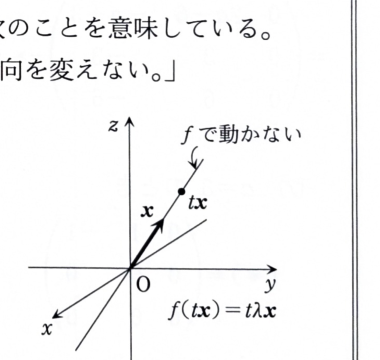

> **資料のワンポイント解説**
>
> 固有ベクトルは、線形変換 \(f(x)=Ax\) によって**方向が変わらない**ベクトルである。
> \(Ax=\lambda x\) であるため、変換後のベクトルは元のベクトルの \(\lambda\) 倍になる。
> \(\lambda>0\) なら向きは同じ、\(\lambda<0\) なら向きが反対になり、\(\lambda=0\) なら零ベクトルに移る。
>
> 
>
> 固有値を求めるときは \(\det(A-\lambda E)=0\) を解き、固有ベクトルを求めるときは
> \((A-\lambda E)x=0\) を解く。

---

例題 1

行列

$$
A=
\begin{pmatrix}
2&a&-1\\
a&2&b\\
-1&b&2
\end{pmatrix}
$$

が固有ベクトル

$$
v=
\begin{pmatrix}
1\\
2\\
1
\end{pmatrix}
$$

をもつとする。次の問いに答えよ。

---

## (1)

成分 \(a,b\) の値を求めよ。

---

## (1) 解答

> **解法を選ぶ理由**
>
> 固有ベクトル \(v\) がすでに与えられているので、固有方程式を先に展開するよりも、
> 定義 \(Av=\lambda v\) を直接使って成分を比較する方法が最も自然である。
> 別解として、\(v\) を含む基底を作り、基底変換後の行列の第1列を調べる方法もあるが、
> この問題では計算が長くなる。

固有ベクトルの定義は

$$
Av=\lambda v
$$

である。まず、値を代入する前の行列とベクトルの積を確認すると、

$$
A
\begin{pmatrix}
x\\
y\\
z
\end{pmatrix}
=
\begin{pmatrix}
2x+ay-z\\
ax+2y+bz\\
-x+by+2z
\end{pmatrix}
$$

である。ここに

$$
x=1,\qquad y=2,\qquad z=1
$$

を代入すると、

$$
Av=
\begin{pmatrix}
2\cdot1+a\cdot2-1\\
a\cdot1+2\cdot2+b\cdot1\\
-1+b\cdot2+2\cdot1
\end{pmatrix}
=
\begin{pmatrix}
2a+1\\
a+b+4\\
2b+1
\end{pmatrix}
$$

となる。一方、

$$
\lambda v
=
\lambda
\begin{pmatrix}
1\\
2\\
1
\end{pmatrix}
=
\begin{pmatrix}
\lambda\\
2\lambda\\
\lambda
\end{pmatrix}
$$

である。よって、対応する成分を比較して

$$
2a+1=\lambda
$$

$$
a+b+4=2\lambda
$$

$$
2b+1=\lambda
$$

を得る。

第1式と第3式はどちらも \(\lambda\) に等しいので、

$$
2a+1=2b+1
$$

$$
2a=2b
$$

$$
a=b
$$

である。次に、代入前の第2式

$$
a+b+4=2\lambda
$$

へ、\(b=a\) と \(\lambda=2a+1\) を代入すると、

$$
a+a+4=2(2a+1)
$$

$$
2a+4=4a+2
$$

$$
2=2a
$$

$$
a=1
$$

となる。したがって、

$$
b=a=1
$$

である。

$$
\boxed{a=1,\qquad b=1}
$$

---

## (2)

\(A\) の固有値をすべて求めよ。

---

## (2) 解答

> **解法を選ぶ理由**
>
> 固有値をすべて求める標準的方法は、固有方程式
> \(\det(A-\lambda E)=0\) を解くことである。
> この行列は対称行列なので直交対角化を利用することもできるが、固有値が未確定であるため、
> まず行列式を計算する方法が直接的である。

(1) より、

$$
A=
\begin{pmatrix}
2&1&-1\\
1&2&1\\
-1&1&2
\end{pmatrix}
$$

である。固有方程式は

$$
\det(A-\lambda E)=0
$$

であるから、

$$
\det
\begin{pmatrix}
2-\lambda&1&-1\\
1&2-\lambda&1\\
-1&1&2-\lambda
\end{pmatrix}
=0
$$

を解く。

第1行で展開する。3次の行列式

$$
\det
\begin{pmatrix}
a&b&c\\
d&e&f\\
g&h&i
\end{pmatrix}
$$

は

$$
a(ei-fh)-b(di-fg)+c(dh-eg)
$$

である。これを使うと、

$$
\begin{aligned}
\det(A-\lambda E)
&=(2-\lambda)
\det
\begin{pmatrix}
2-\lambda&1\\
1&2-\lambda
\end{pmatrix}
-\det
\begin{pmatrix}
1&1\\
-1&2-\lambda
\end{pmatrix}\\
&\quad
-\det
\begin{pmatrix}
1&2-\lambda\\
-1&1
\end{pmatrix}
\end{aligned}
$$

となる。それぞれの2次行列式を計算すると、

$$
\det
\begin{pmatrix}
2-\lambda&1\\
1&2-\lambda
\end{pmatrix}
=(2-\lambda)^2-1
$$

$$
\det
\begin{pmatrix}
1&1\\
-1&2-\lambda
\end{pmatrix}
=2-\lambda+1=3-\lambda
$$

$$
\det
\begin{pmatrix}
1&2-\lambda\\
-1&1
\end{pmatrix}
=1+(2-\lambda)=3-\lambda
$$

である。よって、

$$
\det(A-\lambda E)
=(2-\lambda)\bigl((2-\lambda)^2-1\bigr)-2(3-\lambda)
$$

である。展開すると、

$$
\begin{aligned}
\det(A-\lambda E)
&=(2-\lambda)^3-(2-\lambda)-6+2\lambda\\
&=(2-\lambda)^3+3\lambda-8\\
&=-\lambda^3+6\lambda^2-9\lambda\\
&=-\lambda(\lambda-3)^2
\end{aligned}
$$

となる。したがって、

$$
-\lambda(\lambda-3)^2=0
$$

より、

$$
\lambda=0
$$

または

$$
\lambda=3
$$

である。\(\lambda=3\) は2重根である。

$$
\boxed{\lambda=0,\qquad \lambda=3\ \text{（2重）}}
$$
