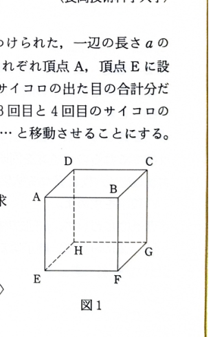

[7C-02]（確率・期待値）

図1のように、各頂点に A〜H の名前がつけられた、一辺の長さ $a$ の立方体を考える。最初に、黒いピンと白いピンが、それぞれ頂点 A、頂点 E に設置してある。

サイコロを4回振り、1回目と2回目のサイコロの出た目の合計分だけ、黒いピンを

$$
A\to B\to C\to D\to A\to\cdots
$$

と移動させる。3回目と4回目のサイコロの出た目の合計分だけ、白いピンを

$$
E\to F\to G\to H\to E\to\cdots
$$

と移動させる。

> 2個のサイコロの和は2〜12である。4頂点の周回なので、和を4で割った余りによって最終頂点が決まる。
>
> 2個のサイコロの全結果は36通りである。和が $2,3,\ldots,12$ となる場合の数は、
>
> $$
> 1,2,3,4,5,6,5,4,3,2,1
> $$
>
> である。

---

## (1)

黒いピンが頂点 C に止まる確率を求めよ。

---

## (1) 解答

> **解法の選択理由**
>
> A から C までは周回方向に2辺進むため、2個のサイコロの和を4で割った余りが2となる場合を数える。

黒いピンが C に止まるのは、サイコロ2回の和が、

$$
2,\ 6,\ 10
$$

のいずれかの場合である。

それぞれの場合の数は、

$$
1,\ 5,\ 3
$$

通りである。

したがって、条件を満たす場合の数は、

$$
1+5+3=9
$$

通りである。

全結果は、

$$
6^2=36
$$

通りなので、

$$
P(\text{黒がC})
=\frac9{36}
=\frac14
$$

よって、

$$
\boxed{\frac14}
$$

---

## (2)

黒いピンと白いピンの距離が $\sqrt2a$ となる確率を求めよ。

---

## (2) 解答

> **解法の選択理由**
>
> まず各ピンの最終頂点の確率分布を求める。黒と白は別々の2回のサイコロで動くため独立である。その後、立方体上で距離が面の対角線 $\sqrt2a$ となる頂点の組を数える。

黒いピンが A、B、C、D に止まる確率を順に求める。

A に止まるのは和が $4,8,12$ のときなので、

$$
P(A)=\frac{3+5+1}{36}
=\frac9{36}
=\frac14
$$

B に止まるのは和が $5,9$ のときなので、

$$
P(B)=\frac{4+4}{36}
=\frac8{36}
=\frac29
$$

C に止まる確率は(1)より、

$$
P(C)=\frac14
$$

D に止まるのは和が $3,7,11$ のときなので、

$$
P(D)=\frac{2+6+2}{36}
=\frac{10}{36}
=\frac5{18}
$$

白いピンについても、E、F、G、H に止まる確率は同じ順序で、

$$
P(E)=\frac14,\quad
P(F)=\frac29,\quad
P(G)=\frac14,\quad
P(H)=\frac5{18}
$$

である。

距離が $\sqrt2a$ となるのは次の2群である。

1. 黒が A または C、白が F または H
2. 黒が B または D、白が E または G

第1群の確率は、

$$
\{P(A)+P(C)\}\{P(F)+P(H)\}
$$

文字の式に値を代入すると、

$$
=\left(\frac14+\frac14\right)
\left(\frac29+\frac5{18}\right)
$$

$$
=\frac12\cdot\frac12
=\frac14
$$

第2群の確率は、

$$
\{P(B)+P(D)\}\{P(E)+P(G)\}
$$

$$
=\left(\frac29+\frac5{18}\right)
\left(\frac14+\frac14\right)
$$

$$
=\frac12\cdot\frac12
=\frac14
$$

2群は排反なので、求める確率は、

$$
\frac14+\frac14=\frac12
$$

よって、

$$
\boxed{\frac12}
$$

---

## (3)

黒いピンと白いピンの距離の期待値を求めよ。無理数は無理数のままでよい。

---

## (3) 解答

> **解法の選択理由**
>
> 2つのピンは上面と下面の頂点にあるため、距離は立方体の辺の長さ $a$、面対角線 $\sqrt2a$、空間対角線 $\sqrt3a$ の3種類だけである。それぞれの確率を求め、期待値の定義
>
> $$
> E(X)=\sum_x xP(X=x)
> $$
>
> を用いる。

距離を確率変数 $X$ とする。

### $X=a$ の確率

上下に対応する頂点、

$$
(A,E),\ (B,F),\ (C,G),\ (D,H)
$$

に止まるとき、距離は $a$ である。

独立性より、

$$
P(X=a)
=P(A)P(E)+P(B)P(F)+P(C)P(G)+P(D)P(H)
$$

値を代入すると、

$$
P(X=a)
=
\left(\frac14\right)^2
+\left(\frac29\right)^2
+\left(\frac14\right)^2
+\left(\frac5{18}\right)^2
$$

$$
=
\frac{81+64+81+100}{1296}
=\frac{326}{1296}
=\frac{163}{648}
$$

### $X=\sqrt2a$ の確率

(2)より、

$$
P(X=\sqrt2a)=\frac12
$$

### $X=\sqrt3a$ の確率

空間対角線の位置関係となる組は、

$$
(A,G),\ (B,H),\ (C,E),\ (D,F)
$$

である。

したがって、

$$
P(X=\sqrt3a)
=P(A)P(G)+P(B)P(H)+P(C)P(E)+P(D)P(F)
$$

値を代入すると、

$$
P(X=\sqrt3a)
=
\frac14\cdot\frac14
+\frac29\cdot\frac5{18}
+\frac14\cdot\frac14
+\frac5{18}\cdot\frac29
$$

$$
=
\frac{81+80+81+80}{1296}
=\frac{322}{1296}
=\frac{161}{648}
$$

> 確率の和は、
>
> $$
> \frac{163}{648}+\frac12+\frac{161}{648}
> =\frac{163+324+161}{648}
> =1
> $$
>
> となる。

期待値の定義より、

$$
E(X)
=aP(X=a)+\sqrt2aP(X=\sqrt2a)+\sqrt3aP(X=\sqrt3a)
$$

値を代入すると、

$$
E(X)
=a\cdot\frac{163}{648}
+\sqrt2a\cdot\frac12
+\sqrt3a\cdot\frac{161}{648}
$$

$$
=
\frac{163+324\sqrt2+161\sqrt3}{648}a
$$

よって、

$$
\boxed{
E(X)=
\frac{163+324\sqrt2+161\sqrt3}{648}a
}
$$
