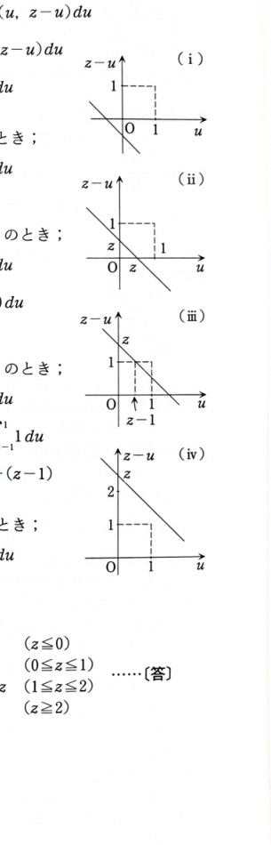

[7D-07]（2変量の確率分布）

$X,Y$ を同一の確率空間上で定義された確率変数とする。$X,Y$ の結合分布関数 $F(x,y)$ は、

$$
F(x,y)=P(X\le x,\ Y\le y)
$$

で定義される。

また、

$$
F(x,y)
=
\int_{-\infty}^{x}
\int_{-\infty}^{y}
f(u,v)\,du\,dv
$$

を満たす非負関数 $f(u,v)$ が存在するとき、$f$ は結合密度関数である。

ここで、

$$
Z=X+Y
$$

とおく。$Z$ の分布関数 $F_Z(z)$ は、

$$
F_Z(z)
=
\iint_{A_z}f(x,y)\,dx\,dy,
\qquad
A_z=\{(x,y)\in\mathbb{R}^2\mid x+y\le z\}
$$

で与えられ、$F_Z(z)$ の密度関数 $f_Z(z)$ は、

$$
F_Z(z)=\int_{-\infty}^{z}f_Z(\zeta)\,d\zeta
$$

により定義される。

---

## (1)

$f_Z(z)$ を積分の形で表せ。

---

## (1) 解答

> **解法の選択理由**
>
> $Z=X+Y$ の密度は、直線 $x+y=z$ 上の結合密度を1変数について積分する「畳み込み」で得られる。資料の解答では変数変換を用いて分布関数を整理している。分布関数を $z$ で微分する方法も同値である。

変数変換を、

$$
u=x,\qquad v=x+y
$$

とする。

逆変換は、

$$
x=u,\qquad y=v-u
$$

である。

ヤコビアンは、

$$
\frac{\partial(x,y)}{\partial(u,v)}
=
\begin{vmatrix}
1&0\\
-1&1
\end{vmatrix}
=1
$$

である。

領域

$$
A_z=\{(x,y)\mid x+y\le z\}
$$

は、新しい変数では、

$$
B_z=\{(u,v)\mid v\le z\}
$$

となる。

したがって、

$$
F_Z(z)
=
\iint_{A_z}f(x,y)\,dx\,dy
$$

$$
=
\iint_{B_z}f(u,v-u)\,du\,dv
$$

積分順序を明示すると、

$$
F_Z(z)
=
\int_{-\infty}^{z}
\left\{
\int_{-\infty}^{\infty}
f(u,v-u)\,du
\right\}dv
$$

一方、密度の定義より、

$$
F_Z(z)
=
\int_{-\infty}^{z}f_Z(v)\,dv
$$

である。

被積分関数を比較すると、

$$
f_Z(v)
=
\int_{-\infty}^{\infty}
f(u,v-u)\,du
$$

したがって、変数名を $z$ に戻すと、

$$
\boxed{
f_Z(z)
=
\int_{-\infty}^{\infty}
f(u,z-u)\,du
}
$$

> 同様に、
>
> $$
> \boxed{
> f_Z(z)
> =
> \int_{-\infty}^{\infty}
> f(z-y,y)\,dy
> }
> $$
>
> と表してもよい。

---

## (2)

$X,Y$ が独立で、ともに $(0,1)$ 上の一様分布に従うとき、$f_Z(z)$ を求めよ。

---

## (2) 解答

> **解法の選択理由**
>
> 独立性より結合密度は周辺密度の積になる。(1)の畳み込み積分に一様分布の密度を代入し、$0<u<1$ かつ $0<z-u<1$ を満たす $u$ の区間の長さを求める。
>
> 資料の積分範囲図を以下に示す。
>
> 

$X,Y$ は独立なので、

$$
f(x,y)=f_X(x)f_Y(y)
$$

である。

$(0,1)$ 上の一様分布の密度は、

$$
f_X(x)=
\begin{cases}
1&(0<x<1),\\
0&(\text{その他})
\end{cases}
$$

$$
f_Y(y)=
\begin{cases}
1&(0<y<1),\\
0&(\text{その他})
\end{cases}
$$

である。

(1)より、

$$
f_Z(z)
=
\int_{-\infty}^{\infty}
f_X(u)f_Y(z-u)\,du
$$

$f_X(u)$ が0でないのは $0<u<1$ なので、

$$
f_Z(z)
=
\int_0^1f_Y(z-u)\,du
$$

である。

さらに $f_Y(z-u)=1$ となる条件は、

$$
0<z-u<1
$$

である。これを $u$ について解くと、

$$
z-1<u<z
$$

となる。

したがって、積分値は区間

$$
(0,1)\cap(z-1,z)
$$

の長さである。

### $z\le0$ の場合

2区間は重ならないので、

$$
f_Z(z)=0
$$

### $0\le z\le1$ の場合

共通部分は、

$$
0<u<z
$$

である。したがって、

$$
f_Z(z)=\int_0^z1\,du=z
$$

### $1\le z\le2$ の場合

共通部分は、

$$
z-1<u<1
$$

である。したがって、

$$
f_Z(z)=\int_{z-1}^{1}1\,du
$$

$$
=1-(z-1)
=2-z
$$

### $z\ge2$ の場合

2区間は重ならないので、

$$
f_Z(z)=0
$$

以上より、

$$
\boxed{
f_Z(z)=
\begin{cases}
0&(z\le0),\\[1mm]
z&(0\le z\le1),\\[1mm]
2-z&(1\le z\le2),\\[1mm]
0&(z\ge2)
\end{cases}
}
$$

> 確認として、
>
> $$
> \int_{-\infty}^{\infty}f_Z(z)\,dz
> =
> \int_0^1z\,dz+\int_1^2(2-z)\,dz
> =\frac12+\frac12=1
> $$
>
> となる。
