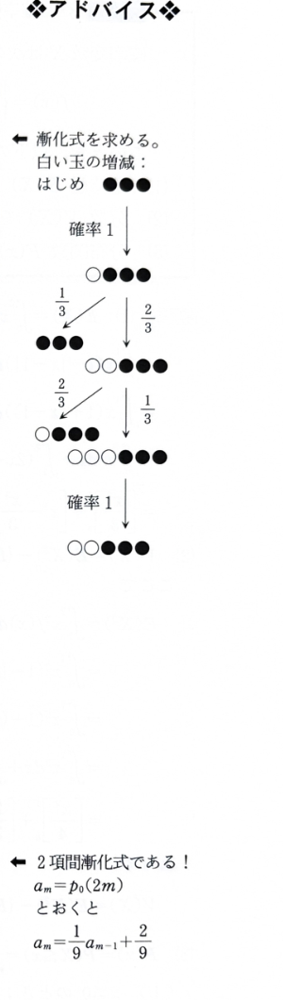

例題2（場合の数と確率②）

赤い玉3個が一列に並んでいる。この列に対して次の操作を繰り返し行う。

列の先頭、2番目、3番目の3つの玉のうちから1つを等確率で選ぶ。選んだ玉が赤い玉なら、それをそのまま置いておき、列の先頭に白い玉を1つ付加する。選んだ玉が白い玉なら、それを取り去り、玉が抜けたために隙間ができれば、玉の順序が変わらないように玉を移動して隙間をなくす。

$n$ 回目の操作の終了時に列にある白い玉の個数を $w(n)$ とする。$w(n)$ は $0,1,2,3$ のいずれかの値をとる。特に、確率1で $w(0)=0$ と定める。

$i=0,1,2,3$ について、$w(n)=i$ である確率を $p_i(n)$ と表す。したがって、

$$
p_0(0)=1,\qquad p_1(0)=p_2(0)=p_3(0)=0
$$

である。

> 1回の操作では、選んだ玉が赤なら白玉が1個増え、白なら白玉が1個減る。したがって、白玉数の偶奇は毎回反転する。
>
> 資料の状態遷移図を以下に示す。
>
> 

---

## (1)

$p_0(1),p_1(1),p_2(1),p_3(1)$ の値をそれぞれ求めよ。

---

## (1) 解答

> **解法の選択理由**
>
> 初期状態では3個すべてが赤玉であるため、1回目には必ず赤玉が選ばれる。したがって、複雑な漸化式を使わず、操作を直接追跡するのが最も簡単である。

1回目は必ず赤玉が選ばれ、その赤玉は残ったまま、先頭に白玉が1個加わる。

したがって、

$$
w(1)=1
$$

が確率1で起こる。

よって、

$$
\boxed{
p_0(1)=0,\quad
p_1(1)=1,\quad
p_2(1)=0,\quad
p_3(1)=0
}
$$

---

## (2)

$m$ を非負整数とするとき、

$$
p_1(2m)=p_3(2m)=0
$$

であることを示せ。

---

## (2) 解答

> **解法の選択理由**
>
> 「偶数回後には白玉数が奇数にならない」という偶奇性だけでも結論は得られる。ただし資料の解答は、$p_1,p_3$ の漸化式を作り、その和が0で保たれることを示している。ここでは資料に沿って漸化式を示し、最後に偶奇性による見方も補足する。

時刻 $2m-2$ で白玉が1個の場合、先頭3個のうち白玉は1個、赤玉は2個である。

2回の操作後に再び白玉が1個となる経路は、次の2種類である。

- 1回目に白玉を選んで白玉数が0になり、2回目に赤玉を選んで1に戻る。
- 1回目に赤玉を選んで白玉数が2になり、2回目に白玉を選んで1に戻る。

したがって、状態1から状態1へ2回で戻る確率は、

$$
\frac13\cdot1+\frac23\cdot\frac23
=\frac13+\frac49
=\frac79
$$

である。

また、時刻 $2m-2$ で白玉が3個の場合、1回目には必ず白玉を選び白玉数が2になり、2回目に白玉を選べば白玉数が1になる。この確率は、

$$
1\cdot\frac23=\frac23
$$

である。

よって、

$$
p_1(2m)
=\frac79p_1(2m-2)+\frac23p_3(2m-2)
\tag{1}
$$

同様に、状態1から2回後に状態3へ移るには、赤玉を2回続けて選ぶ必要がある。その確率は、

$$
\frac23\cdot\frac13=\frac29
$$

である。

状態3から2回後に状態3へ戻るには、1回目に必ず白玉を選び状態2になった後、2回目に赤玉を選ぶ。その確率は、

$$
1\cdot\frac13=\frac13
$$

である。

したがって、

$$
p_3(2m)
=\frac29p_1(2m-2)+\frac13p_3(2m-2)
\tag{2}
$$

(1)と(2)を加えると、

$$
p_1(2m)+p_3(2m)
=p_1(2m-2)+p_3(2m-2)
$$

この関係を繰り返し用いると、

$$
p_1(2m)+p_3(2m)
=p_1(0)+p_3(0)
=0
$$

確率は負にならないので、2つの非負数の和が0であるためには両方が0でなければならない。

よって、

$$
\boxed{p_1(2m)=p_3(2m)=0}
$$

> 別の見方として、白玉数は1回ごとに必ず $+1$ または $-1$ だけ変化するので、初期値0から偶数回後には偶数個、奇数回後には奇数個になる。この偶奇性からも結論が直ちに分かる。

---

## (3)

$m$ を1以上の整数とするとき、$p_0(2m)$ と $p_2(2m)$ を $p_0(2m-2)$ と $p_2(2m-2)$ を用いて表せ。

---

## (3) 解答

> **解法の選択理由**
>
> 偶数時刻には(2)より状態0または状態2しか起こらない。したがって、この2状態間の「2回分の遷移確率」を求めれば、2本の漸化式が得られる。

時刻 $2m-2$ で白玉数が0のとき、1回目には必ず赤玉を選び、白玉数は1になる。

そこから2回目に白玉を選ぶ確率は $\frac13$ なので、2回後に白玉数が0となる確率は、

$$
1\cdot\frac13=\frac13
$$

である。

時刻 $2m-2$ で白玉数が2のとき、2回後に白玉数が0となるには、白玉を2回続けて選ぶ必要がある。1回目に白玉を選ぶ確率は $\frac23$、白玉数が1になった後に白玉を選ぶ確率は $\frac13$ なので、

$$
\frac23\cdot\frac13=\frac29
$$

である。

したがって、

$$
\boxed{
p_0(2m)
=\frac13p_0(2m-2)+\frac29p_2(2m-2)
}
\tag{3}
$$

次に、時刻 $2m-2$ で白玉数が0のとき、2回後に白玉数が2となるには、赤玉を2回続けて選ぶ。1回目は確率1、2回目は白玉1個・赤玉3個の先頭3個中、赤玉を選ぶ確率が $\frac23$ であるため、

$$
1\cdot\frac23=\frac23
$$

である。

時刻 $2m-2$ で白玉数が2のとき、2回後に白玉数が2となる確率は、全確率1から状態0へ行く確率 $\frac29$ を引いて、

$$
1-\frac29=\frac79
$$

である。

よって、

$$
\boxed{
p_2(2m)
=\frac23p_0(2m-2)+\frac79p_2(2m-2)
}
\tag{4}
$$

---

## (4)

非負整数 $m$ について、$p_0(2m)$ を求めよ。

---

## (4) 解答

> **解法の選択理由**
>
> (3)の2本の漸化式を加えると確率の和が1であることが分かるため、$p_2(2m-2)=1-p_0(2m-2)$ と消去できる。すると $p_0$ だけの一次漸化式になる。行列を用いて2状態の遷移を対角化する方法もあるが、この問題では一次漸化式の方が短い。

(3)、(4)を加えると、

$$
p_0(2m)+p_2(2m)
=p_0(2m-2)+p_2(2m-2)
$$

初期時刻では、

$$
p_0(0)+p_2(0)=1
$$

なので、すべての $m$ について、

$$
p_0(2m)+p_2(2m)=1
$$

したがって、

$$
p_2(2m-2)=1-p_0(2m-2)
$$

これを(3)に代入する。代入前の式は、

$$
p_0(2m)
=\frac13p_0(2m-2)+\frac29p_2(2m-2)
$$

である。代入すると、

$$
p_0(2m)
=\frac13p_0(2m-2)
+\frac29\{1-p_0(2m-2)\}
$$

$$
=\left(\frac13-\frac29\right)p_0(2m-2)+\frac29
$$

$$
=\frac19p_0(2m-2)+\frac29
$$

定常値を求めるため、定数 $\alpha$ が

$$
\alpha=\frac19\alpha+\frac29
$$

を満たすとする。整理すると、

$$
\frac89\alpha=\frac29
$$

$$
\alpha=\frac14
$$

したがって、

$$
p_0(2m)-\frac14
=\frac19\left\{p_0(2m-2)-\frac14\right\}
$$

この関係を $m$ 回繰り返すと、

$$
p_0(2m)-\frac14
=\left(\frac19\right)^m
\left\{p_0(0)-\frac14\right\}
$$

初期値 $p_0(0)=1$ を代入すると、

$$
p_0(2m)-\frac14
=\left(\frac19\right)^m\cdot\frac34
$$

よって、

$$
\boxed{
p_0(2m)=\frac14+\frac34\left(\frac19\right)^m
}
$$
