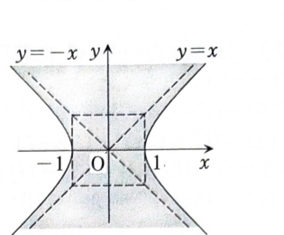

> **事前知識：複素数の実部**
>
> $z=x+iy$ のとき、
>
> $$
> z^2=(x+iy)^2=x^2-y^2+2xy\,i
> $$
>
> である。したがって、
>
> $$
> \operatorname{Re}(z^2)=x^2-y^2
> $$
>
> である。

---

8A-02（複素平面）

次の条件を満たす点 $z=x+iy$ の存在範囲を図示せよ。

$$
\operatorname{Re}(z^2)<1
$$

---

## 解答

> 条件が実部を含むので、$z=x+iy$ と置いて実部を実数 $x,y$ の式に直す。得られる不等式は双曲線の内外を表す。境界は不等号が厳密な「$<$」なので含まれない。

まず、

$$
z=x+iy
$$

とおく。平方する前の式は

$$
z^2=(x+iy)^2
$$

であり、展開すると、

$$
z^2=x^2+2xy\,i+i^2y^2
$$

である。$i^2=-1$ を代入すると、

$$
z^2=x^2-y^2+2xy\,i
$$

となる。したがって、

$$
\operatorname{Re}(z^2)=x^2-y^2
$$

である。

もとの条件

$$
\operatorname{Re}(z^2)<1
$$

に代入すると、

$$
x^2-y^2<1
$$

を得る。境界は、

$$
x^2-y^2=1
$$

であり、これは $x$ 軸方向に開く双曲線である。

不等式の向きを確かめるため、原点 $(0,0)$ を代入すると、

$$
0^2-0^2=0<1
$$

であるから、原点を含む側が求める領域である。すなわち、双曲線の2本の枝の間にある領域であり、上下方向へ無限に広がる。

したがって、求める範囲は

$$
\boxed{\{\,x+iy\mid x^2-y^2<1\,\}}
$$

である。境界 $x^2-y^2=1$ は含まれない。
