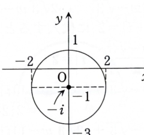
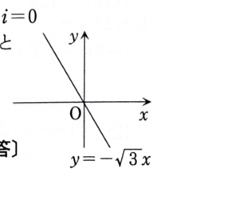

> **事前知識：複素平面上の距離**
>
> 複素数 $z$ と定数 $a$ に対して、$|z-a|$ は複素平面上の点 $z$ と点 $a$ の距離を表す。したがって、
>
> $$
> |z-a|=r
> $$
>
> は中心 $a$、半径 $r$ の円である。
>
> 2定点からの距離の比が一定で1でない点の軌跡はアポロニウスの円である。2定点から等距離となる点の軌跡は、その2点を結ぶ線分の垂直二等分線である。

---

8A-03（複素平面における円と直線）

## (1)

方程式

$$
|5z-i|=|3z-7i|
$$

を満足する $z$ を複素平面上で図示し、どのような図形となるか答えよ。

---

## (1) 解答

> 絶対値を2乗して $z\bar z$ を用いる方法、$z=x+iy$ と置いて座標方程式にする方法、2定点からの距離比としてアポロニウスの円を使う方法がある。図形の中心と半径を確実に求めるため、座標表示で平方完成する方法を主解法とする。

$z=x+iy$ とおく。まず、

$$
5z-i=5(x+iy)-i
$$

であり、

$$
5z-i=5x+i(5y-1)
$$

だから、

$$
|5z-i|^2=(5x)^2+(5y-1)^2
$$

である。同様に、

$$
3z-7i=3(x+iy)-7i
$$

より、

$$
3z-7i=3x+i(3y-7)
$$

だから、

$$
|3z-7i|^2=(3x)^2+(3y-7)^2
$$

である。

もとの式

$$
|5z-i|=|3z-7i|
$$

の両辺は非負なので、2乗しても同値である。したがって、

$$
(5x)^2+(5y-1)^2
=(3x)^2+(3y-7)^2
$$

となる。展開すると、

$$
25x^2+25y^2-10y+1
=9x^2+9y^2-42y+49
$$

である。左辺にまとめると、

$$
16x^2+16y^2+32y-48=0
$$

となる。16で割ると、

$$
x^2+y^2+2y-3=0
$$

である。$y$ に関して平方完成すると、

$$
y^2+2y=(y+1)^2-1
$$

だから、

$$
x^2+(y+1)^2-1-3=0
$$

よって、

$$
x^2+(y+1)^2=4
$$

となる。

これは、複素平面では

$$
|z+i|=2
$$

と表せる。したがって、

$$
\boxed{\text{中心 }-i,\ \text{半径 }2\text{ の円}}
$$

である。

> 別解として、
>
> $$
> |5z-i|=5\left|z-\frac15i\right|,
> \qquad
> |3z-7i|=3\left|z-\frac73i\right|
> $$
>
> と変形すると、2点 $\dfrac15i$、$\dfrac73i$ からの距離比が $3:5$ である点の軌跡、すなわちアポロニウスの円と分かる。

---

## (2)

$z$ に対し、

$$
w=\frac{\frac{\sqrt3}{3}z-1}{2z+2\sqrt3}
$$

なる変数変換を行った場合、$w$ が満たす方程式を複素平面上で図示せよ。

---

## (2) 解答

> (1)で得た円 $|z+i|=2$ に、一次分数変換の逆変換 $z=z(w)$ を代入する。絶対値方程式を整理すると、2点から等距離という形になり、直線として読み取れる。実部・虚部へ展開する方法もあるが、等距離の形を保つ方が幾何学的に分かりやすい。

まず変換式を整理する。分子分母を3倍して、

$$
w=\frac{\sqrt3z-3}{6z+6\sqrt3}
$$

である。両辺を交差させると、

$$
w(6z+6\sqrt3)=\sqrt3z-3
$$

したがって、

$$
6wz+6\sqrt3w=\sqrt3z-3
$$

である。$z$ を含む項をまとめると、

$$
(6w-\sqrt3)z=-6\sqrt3w-3
$$

よって、

$$
z=\frac{-6\sqrt3w-3}{6w-\sqrt3}
$$

となる。分子分母を $\sqrt3$ で割ると、

$$
z=\frac{-6w-\sqrt3}{2\sqrt3w-1}
$$

である。

(1)の円の方程式は、

$$
|z+i|=2
$$

である。逆変換を代入する前の式は、

$$
\left|
\frac{-6w-\sqrt3}{2\sqrt3w-1}+i
\right|=2
$$

である。通分すると、

$$
\left|
\frac{-6w-\sqrt3+(2\sqrt3w-1)i}{2\sqrt3w-1}
\right|=2
$$

したがって、

$$
|-6w-\sqrt3+(2\sqrt3w-1)i|
=2|2\sqrt3w-1|
$$

となる。

$w=x+iy$ とおく。左辺の中を実部と虚部に分けると、

$$
-6w-\sqrt3+(2\sqrt3w-1)i
$$

$$
=-6(x+iy)-\sqrt3
+\{2\sqrt3(x+iy)-1\}i
$$

である。$i^2=-1$ を用いて整理すると、

$$
=(-6x-\sqrt3-2\sqrt3y)
+i(-6y+2\sqrt3x-1)
$$

となる。両辺を2乗すると、

$$
(-6x-\sqrt3-2\sqrt3y)^2
+(-6y+2\sqrt3x-1)^2
$$

$$
=4\{(2\sqrt3x-1)^2+(2\sqrt3y)^2\}
$$

である。展開して整理すると、

$$
12x^2+12y^2+2\sqrt3x+6y+1
=
12x^2+12y^2-4\sqrt3x+1
$$

となる。共通項を消去すると、

$$
2\sqrt3x+6y=-4\sqrt3x
$$

したがって、

$$
6\sqrt3x+6y=0
$$

であり、

$$
y=-\sqrt3x
$$

を得る。

よって、求める図形は

$$
\boxed{y=-\sqrt3x}
$$

すなわち原点を通り、傾きが $-\sqrt3$ の直線である。

> 別解として、整理の途中で2点から等距離となる形
>
> $$
> \left|w-\frac{-\sqrt3-3i}{12}\right|
> =
> \left|w-\frac{\sqrt3}{6}\right|
> $$
>
> を得れば、2点を結ぶ線分の垂直二等分線と判断できる。
