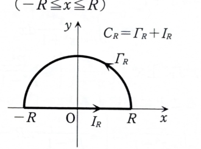

> **事前知識：留数定理による実積分**
>
> 実軸上の積分
>
> $$
> \int_{-\infty}^{\infty}R(x)\,dx
> $$
>
> を求めるとき、上半平面の半円と実軸上の線分からなる閉曲線を用いることがある。閉曲線積分を留数定理で求め、半円弧上の積分が $R\to\infty$ で0になることを示せば、実軸上の積分が得られる。

---

8B-02（留数の応用）

留数解析を用いて次の積分値を求めよ。

$$
\int_{-\infty}^{\infty}\frac{x^4}{1+x^6}\,dx
=
\int_{-\infty}^{\infty}
\frac{x^4}{(x^2+1)(x^4-x^2+1)}\,dx
$$

---

## 解答

> 被積分関数を複素関数 $f(z)=\dfrac{z^4}{z^6+1}$ に拡張し、上半平面の半円輪郭で留数定理を使う。分母の次数が分子より2高いので、大半円弧上の積分は0に収束する。偶関数として $0$ から $\infty$ に半分にする方法もあるが、資料に沿って全実軸を直接扱う。

複素関数を

$$
f(z)=\frac{z^4}{z^6+1}
$$

とする。特異点は、

$$
z^6+1=0
$$

を満たす点である。これは、

$$
z^6=-1=e^{i(\pi+2k\pi)}
$$

だから、

$$
z=e^{i\frac{(2k+1)\pi}{6}}
\qquad(k=0,1,\dots,5)
$$

である。

上半平面にある3つの極を

$$
a_1=e^{i\pi/6}=\frac{\sqrt3+i}{2},
$$

$$
a_2=e^{i\pi/2}=i,
$$

$$
a_3=e^{i5\pi/6}=\frac{-\sqrt3+i}{2}
$$

とする。いずれも1位の極である。

1位の極 $a$ における留数は、分母の微分を用いて

$$
\operatorname{Res}(f,a)
=\frac{a^4}{(z^6+1)'|_{z=a}}
$$

である。微分する前の分母は

$$
z^6+1
$$

であり、その微分は

$$
(z^6+1)'=6z^5
$$

だから、

$$
\operatorname{Res}(f,a)
=\frac{a^4}{6a^5}
=\frac1{6a}
$$

である。

したがって、

$$
\operatorname{Res}(f,a_1)
=\frac1{6a_1}
$$

である。$|a_1|=1$ なので $1/a_1=\overline{a_1}$ であり、

$$
\frac1{a_1}=\frac{\sqrt3-i}{2}
$$

だから、

$$
\operatorname{Res}(f,a_1)
=\frac{\sqrt3-i}{12}
$$

である。

同様に、

$$
\operatorname{Res}(f,a_2)
=\frac1{6i}
=-\frac{i}{6}
$$

である。また、

$$
\frac1{a_3}=\overline{a_3}
=\frac{-\sqrt3-i}{2}
$$

だから、

$$
\operatorname{Res}(f,a_3)
=\frac{-\sqrt3-i}{12}
$$

である。

3つの留数の和は、

$$
\frac{\sqrt3-i}{12}
-\frac{i}{6}
+\frac{-\sqrt3-i}{12}
$$

である。実部は打ち消し合い、虚部は

$$
-\frac{i}{12}-\frac{2i}{12}-\frac{i}{12}
=-\frac{4i}{12}
=-\frac{i}{3}
$$

だから、

$$
\sum_{k=1}^3\operatorname{Res}(f,a_k)
=-\frac{i}{3}
$$

である。

上半円弧 $\Gamma_R$ と実軸上の線分 $[-R,R]$ からなる閉曲線 $C_R$ を正方向にとる。留数定理より、

$$
\oint_{C_R}f(z)\,dz
=2\pi i\left(-\frac{i}{3}\right)
=\frac{2\pi}{3}
$$

である。

一方、

$$
\oint_{C_R}f(z)\,dz
=
\int_{-R}^{R}\frac{x^4}{x^6+1}\,dx
+
\int_{\Gamma_R}\frac{z^4}{z^6+1}\,dz
$$

である。

大半円弧上では $|z|=R$ なので、

$$
\left|\frac{z^4}{z^6+1}\right|
\le
\frac{R^4}{R^6-1}
$$

である。また、半円弧の長さは $\pi R$ だから、ML不等式より、

$$
\left|
\int_{\Gamma_R}\frac{z^4}{z^6+1}\,dz
\right|
\le
\frac{R^4}{R^6-1}\pi R
=
\frac{\pi R^5}{R^6-1}
$$

である。右辺は、

$$
\lim_{R\to\infty}
\frac{\pi R^5}{R^6-1}
=0
$$

なので、

$$
\lim_{R\to\infty}
\int_{\Gamma_R}\frac{z^4}{z^6+1}\,dz
=0
$$

である。

したがって、$R\to\infty$ とすると、

$$
\int_{-\infty}^{\infty}
\frac{x^4}{x^6+1}\,dx
=
\frac{2\pi}{3}
$$

となる。

よって、

$$
\boxed{
\int_{-\infty}^{\infty}
\frac{x^4}{1+x^6}\,dx
=\frac{2\pi}{3}
}
$$

である。
