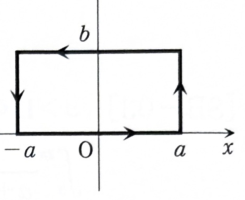

> **事前知識：ガウス積分の標準的な考え方**
>
> 1変数積分
>
> $$
> J=\int_{-\infty}^{\infty}e^{-x^2}\,dx
> $$
>
> を直接原始関数で求めることはできない。そこで $J^2$ を平面全体の2重積分に直し、極座標
>
> $$
> x=r\cos\theta,\qquad y=r\sin\theta,\qquad dx\,dy=r\,dr\,d\theta
> $$
>
> を用いる。

---

8B-06（複素解析）

## (1)

次の式が成り立つことを示せ。

$$
\int_{-\infty}^{\infty}e^{-x^2}\,dx=\sqrt\pi
$$

---

## (1) 解答

> ガウス積分は1回の積分では原始関数が初等関数で表せない。積分の平方を2重積分として計算する方法が標準的で、資料もこの方法を採用している。積分値は正であるため、最後に正の平方根を選ぶ。

次の2重積分を考える。

$$
I=\iint_{\mathbb R^2}e^{-x^2-y^2}\,dx\,dy
$$

まず半径 $n$ の円板

$$
D_n=\{(x,y)\mid x^2+y^2\le n^2\}
$$

上で積分する。極座標変換前の積分は、

$$
\iint_{D_n}e^{-x^2-y^2}\,dx\,dy
$$

である。極座標

$$
x=r\cos\theta,\qquad y=r\sin\theta
$$

を用いると、

$$
x^2+y^2=r^2
$$

であり、ヤコビアンは $r$ だから、

$$
dx\,dy=r\,dr\,d\theta
$$

となる。また領域は、

$$
0\le r\le n,\qquad 0\le\theta\le2\pi
$$

に移る。したがって、

$$
\iint_{D_n}e^{-x^2-y^2}\,dx\,dy
=
\int_0^{2\pi}\int_0^n e^{-r^2}r\,dr\,d\theta
$$

である。

内側の積分では、

$$
\frac{d}{dr}e^{-r^2}=-2re^{-r^2}
$$

なので、

$$
\int e^{-r^2}r\,dr
=-\frac12e^{-r^2}
$$

である。よって、

$$
\int_0^n e^{-r^2}r\,dr
=
\left[-\frac12e^{-r^2}\right]_0^n
=
\frac12(1-e^{-n^2})
$$

となる。したがって、

$$
\iint_{D_n}e^{-x^2-y^2}\,dx\,dy
=
\int_0^{2\pi}
\frac12(1-e^{-n^2})\,d\theta
$$

$$
=\pi(1-e^{-n^2})
$$

である。$n\to\infty$ とすると、

$$
I
=
\lim_{n\to\infty}\pi(1-e^{-n^2})
=\pi
$$

を得る。

一方、正方形

$$
D_n'=\{(x,y)\mid -n\le x\le n,\ -n\le y\le n\}
$$

上の積分は、積の形に分離できる。

$$
\iint_{D_n'}e^{-x^2-y^2}\,dx\,dy
=
\int_{-n}^{n}\int_{-n}^{n}e^{-x^2}e^{-y^2}\,dy\,dx
$$

$$
=
\left(\int_{-n}^{n}e^{-x^2}\,dx\right)
\left(\int_{-n}^{n}e^{-y^2}\,dy\right)
$$

変数名は積分値に影響しないので、

$$
\iint_{D_n'}e^{-x^2-y^2}\,dx\,dy
=
\left(\int_{-n}^{n}e^{-x^2}\,dx\right)^2
$$

である。$n\to\infty$ とすると、

$$
I
=
\left(
\int_{-\infty}^{\infty}e^{-x^2}\,dx
\right)^2
$$

である。先ほど $I=\pi$ と求めたから、

$$
\left(
\int_{-\infty}^{\infty}e^{-x^2}\,dx
\right)^2
=\pi
$$

となる。被積分関数 $e^{-x^2}$ は常に正なので積分値も正である。したがって、

$$
\boxed{
\int_{-\infty}^{\infty}e^{-x^2}\,dx=\sqrt\pi
}
$$

である。

---

## (2)

複素関数

$$
f(z)=e^{-z^2}
$$

を図の四辺形に沿って積分することにより、$a>0$、$b>0$ のとき次の定積分の値を求めよ。

$$
\int_{-\infty}^{\infty}e^{-2ibx-x^2}\,dx
$$

---

## (2) 解答

> $e^{-z^2}$ は全平面で正則なので、長方形の周回積分は0である。下辺のガウス積分と上辺の求める積分を対応させ、左右の辺の積分が $a\to\infty$ で0になることを示す。平方完成でも同じ答えが得られるが、問題の指示どおり複素積分を用いる。

長方形の辺を次のように分ける。

$$
C_1:z=x,\qquad -a\le x\le a
$$

$$
C_2:z=a+iy,\qquad 0\le y\le b
$$

$$
C_3:z=x+bi,\qquad a\ge x\ge-a
$$

$$
C_4:z=-a+iy,\qquad b\ge y\ge0
$$

関数 $e^{-z^2}$ は全関数なので、コーシーの積分定理より、

$$
\int_{C_1}e^{-z^2}\,dz
+\int_{C_2}e^{-z^2}\,dz
+\int_{C_3}e^{-z^2}\,dz
+\int_{C_4}e^{-z^2}\,dz
=0
$$

である。

各辺を計算する。まず $C_1$ では $z=x$、$dz=dx$ だから、

$$
\int_{C_1}e^{-z^2}\,dz
=
\int_{-a}^{a}e^{-x^2}\,dx
$$

である。

$C_2$ では $z=a+iy$、$dz=i\,dy$ だから、

$$
\int_{C_2}e^{-z^2}\,dz
=
i\int_0^b e^{-(a+iy)^2}\,dy
$$

である。指数を展開すると、

$$
-(a+iy)^2
=-a^2-2aiy+y^2
$$

なので、

$$
\int_{C_2}e^{-z^2}\,dz
=
ie^{-a^2}
\int_0^b e^{-2aiy+y^2}\,dy
$$

となる。

$C_3$ では向きが $x=a$ から $x=-a$ であるから、

$$
\int_{C_3}e^{-z^2}\,dz
=
\int_a^{-a}e^{-(x+bi)^2}\,dx
$$

である。指数を展開すると、

$$
-(x+bi)^2
=-x^2-2bix+b^2
$$

だから、

$$
\int_{C_3}e^{-z^2}\,dz
=
-e^{b^2}\int_{-a}^{a}e^{-2bix-x^2}\,dx
$$

である。

$C_4$ では $z=-a+iy$、向きは $y=b$ から $y=0$、$dz=i\,dy$ なので、

$$
\int_{C_4}e^{-z^2}\,dz
=
i\int_b^0 e^{-(-a+iy)^2}\,dy
$$

である。指数は、

$$
-(-a+iy)^2
=-a^2+2aiy+y^2
$$

だから、

$$
\int_{C_4}e^{-z^2}\,dz
=
-ie^{-a^2}
\int_0^b e^{2aiy+y^2}\,dy
$$

となる。

4辺の和が0であることから、

$$
\int_{-a}^{a}e^{-x^2}\,dx
+ie^{-a^2}\int_0^b e^{-2aiy+y^2}\,dy
$$

$$
-e^{b^2}\int_{-a}^{a}e^{-2bix-x^2}\,dx
-ie^{-a^2}\int_0^b e^{2aiy+y^2}\,dy
=0
$$

である。

左右の辺の積分は、$0\le y\le b$ において $|e^{\pm2aiy}|=1$ なので、

$$
\left|
e^{-a^2}\int_0^b e^{\pm2aiy+y^2}\,dy
\right|
\le
e^{-a^2}\int_0^b e^{y^2}\,dy
$$

である。右辺は $a\to\infty$ で0に収束する。

したがって $a\to\infty$ とすると、

$$
\int_{-\infty}^{\infty}e^{-x^2}\,dx
-
e^{b^2}
\int_{-\infty}^{\infty}e^{-2bix-x^2}\,dx
=0
$$

となる。(1)の結果を代入する前の式は、

$$
e^{b^2}
\int_{-\infty}^{\infty}e^{-2bix-x^2}\,dx
=
\int_{-\infty}^{\infty}e^{-x^2}\,dx
$$

である。右辺に

$$
\int_{-\infty}^{\infty}e^{-x^2}\,dx=\sqrt\pi
$$

を代入すると、

$$
e^{b^2}
\int_{-\infty}^{\infty}e^{-2bix-x^2}\,dx
=\sqrt\pi
$$

よって、

$$
\boxed{
\int_{-\infty}^{\infty}e^{-2ibx-x^2}\,dx
=\sqrt\pi\,e^{-b^2}
}
$$

である。

> 平方完成による確認では、
>
> $$
> -x^2-2ibx=-(x+ib)^2-b^2
> $$
>
> となるため、積分路を実軸から高さ $b$ の平行線へ移す議論と同じ構造になっている。
