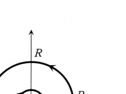

> **事前知識：半円弧とジョルダン型評価**
>
> 上半平面の半円弧
>
> $$
> C_R(0):z=Re^{i\theta},\qquad 0\le\theta\le\pi
> $$
>
> 上では、
>
> $$
> e^{iz}=e^{iR\cos\theta-R\sin\theta}
> $$
>
> となるため、
>
> $$
> |e^{iz}|=e^{-R\sin\theta}
> $$
>
> である。これを利用して大円弧上の積分を0に評価する。

---

8B-09（複素積分）

複素平面上の中心 $a$、半径 $r$ の半円 $C_r(a)$ を

$$
C_r(a)=\{z=a+re^{i\theta}\mid0\le\theta\le\pi\}
$$

で定める。

## (1)

正則関数 $f(z)$ に対して、次式を示せ。$z=a+\varepsilon e^{i\theta}$ とおいて考えよ。

$$
\lim_{\varepsilon\to0}
\int_{C_\varepsilon(a)}
\frac{f(z)}{z-a}\,dz
=i\pi f(a)
$$

---

## (1) 解答

> 半円を直接パラメータ表示すると、$z-a$ と $dz$ の指数因子が打ち消し合い、$f(a+\varepsilon e^{i\theta})$ の積分だけになる。正則関数は連続なので、$\varepsilon\to0$ で一様に $f(a)$ へ近づく。

半円を

$$
z=a+\varepsilon e^{i\theta},
\qquad 0\le\theta\le\pi
$$

と表す。このとき、

$$
z-a=\varepsilon e^{i\theta}
$$

であり、

$$
dz=i\varepsilon e^{i\theta}\,d\theta
$$

である。

代入前の積分は、

$$
\int_{C_\varepsilon(a)}
\frac{f(z)}{z-a}\,dz
$$

である。パラメータ表示を代入すると、

$$
\int_0^\pi
\frac{f(a+\varepsilon e^{i\theta})}
{\varepsilon e^{i\theta}}
i\varepsilon e^{i\theta}\,d\theta
$$

となる。約分して、

$$
\int_{C_\varepsilon(a)}
\frac{f(z)}{z-a}\,dz
=
i\int_0^\pi
f(a+\varepsilon e^{i\theta})\,d\theta
$$

である。

$f$ は $a$ の近傍で正則だから連続であり、

$$
\lim_{\varepsilon\to0}
f(a+\varepsilon e^{i\theta})
=f(a)
$$

である。したがって、

$$
\lim_{\varepsilon\to0}
\int_{C_\varepsilon(a)}
\frac{f(z)}{z-a}\,dz
=
i\int_0^\pi f(a)\,d\theta
$$

となる。右辺を積分すると、

$$
i\int_0^\pi f(a)\,d\theta
=i\pi f(a)
$$

である。よって、

$$
\boxed{
\lim_{\varepsilon\to0}
\int_{C_\varepsilon(a)}
\frac{f(z)}{z-a}\,dz
=i\pi f(a)
}
$$

が示された。

---

## (2)

不等式

$$
\frac{2}{\pi}\theta\le\sin\theta
\qquad
\left(0\le\theta\le\frac\pi2\right)
$$

が成立することを示せ。

---

## (2) 解答

> 資料の解答に沿い、差 $g(\theta)=\sin\theta-\dfrac2\pi\theta$ を考えて増減を調べる。$\sin\theta$ の凹性を用いて、弦の上にグラフがあると説明する方法もある。

関数を

$$
g(\theta)
=
\sin\theta-\frac2\pi\theta
$$

とおく。示したい不等式は、

$$
g(\theta)\ge0
$$

と同値である。

微分すると、

$$
g'(\theta)
=
\cos\theta-\frac2\pi
$$

である。$0<\dfrac2\pi<1$ なので、

$$
\cos\alpha=\frac2\pi
$$

を満たす $\alpha$ が

$$
0<\alpha<\frac\pi2
$$

にただ1つ存在する。

$0<\theta<\alpha$ では、

$$
\cos\theta>\cos\alpha=\frac2\pi
$$

だから、

$$
g'(\theta)>0
$$

である。一方、$\alpha<\theta<\dfrac\pi2$ では、

$$
\cos\theta<\cos\alpha=\frac2\pi
$$

だから、

$$
g'(\theta)<0
$$

である。したがって、$g$ は $0$ から $\alpha$ まで増加し、$\alpha$ から $\dfrac\pi2$ まで減少する。

両端の値は、

$$
g(0)
=\sin0-\frac2\pi\cdot0
=0
$$

であり、

$$
g\left(\frac\pi2\right)
=
\sin\frac\pi2
-\frac2\pi\cdot\frac\pi2
=1-1
=0
$$

である。途中で増加してから減少し、両端で0なので、区間全体で

$$
g(\theta)\ge0
$$

である。

したがって、

$$
\boxed{
\frac2\pi\theta\le\sin\theta
\qquad
\left(0\le\theta\le\frac\pi2\right)
}
$$

が示された。

---

## (3)

(2)の結果を用いて次式を証明せよ。

$$
\lim_{R\to\infty}
\int_{C_R(0)}
\frac{e^{iz}}{z}\,dz
=0
$$

---

## (3) 解答

> 大半円をパラメータ表示し、絶対値を評価する。$|e^{iR\cos\theta}|=1$ と $e^{-R\sin\theta}$ を分離し、(2)によって指数関数的減衰を得る。半円の左右対称性も利用する。

大半円を

$$
z=Re^{i\theta},
\qquad 0\le\theta\le\pi
$$

と表す。このとき、

$$
dz=iRe^{i\theta}\,d\theta
$$

である。代入前の積分は、

$$
\int_{C_R(0)}
\frac{e^{iz}}{z}\,dz
$$

である。パラメータ表示を代入すると、

$$
\int_0^\pi
\frac{e^{iRe^{i\theta}}}
{Re^{i\theta}}
iRe^{i\theta}\,d\theta
$$

となり、

$$
\int_{C_R(0)}
\frac{e^{iz}}{z}\,dz
=
i\int_0^\pi e^{iRe^{i\theta}}\,d\theta
$$

である。

ここで、

$$
iRe^{i\theta}
=iR(\cos\theta+i\sin\theta)
=iR\cos\theta-R\sin\theta
$$

だから、

$$
e^{iRe^{i\theta}}
=
e^{iR\cos\theta}e^{-R\sin\theta}
$$

である。したがって、

$$
\left|
\int_{C_R(0)}
\frac{e^{iz}}{z}\,dz
\right|
\le
\int_0^\pi e^{-R\sin\theta}\,d\theta
$$

となる。

$\sin\theta$ は $\theta=\dfrac\pi2$ に関して対称なので、

$$
\int_0^\pi e^{-R\sin\theta}\,d\theta
=
2\int_0^{\pi/2}e^{-R\sin\theta}\,d\theta
$$

である。(2)より、

$$
\sin\theta\ge\frac2\pi\theta
$$

だから、

$$
e^{-R\sin\theta}
\le
e^{-\frac{2R}{\pi}\theta}
$$

である。よって、

$$
\left|
\int_{C_R(0)}
\frac{e^{iz}}{z}\,dz
\right|
\le
2\int_0^{\pi/2}
e^{-\frac{2R}{\pi}\theta}\,d\theta
$$

となる。積分すると、

$$
2
\left[
-\frac{\pi}{2R}
e^{-\frac{2R}{\pi}\theta}
\right]_0^{\pi/2}
$$

であり、

$$
2\cdot\frac{\pi}{2R}(1-e^{-R})
=
\frac{\pi}{R}(1-e^{-R})
$$

となる。$R\to\infty$ で、

$$
\frac{\pi}{R}(1-e^{-R})\to0
$$

だから、はさみうちにより、

$$
\boxed{
\lim_{R\to\infty}
\int_{C_R(0)}
\frac{e^{iz}}{z}\,dz
=0
}
$$

である。

---

## (4)

図の矢印に示す道に沿って関数

$$
\frac{e^{iz}}{z}
$$

を積分することにより、次の定積分の値を計算せよ。

$$
\int_0^\infty\frac{\sin x}{x}\,dx
$$

---

## (4) 解答

> 実軸上に特異点 $z=0$ があるため、小半円で原点を上側から避ける。大半円、小半円、正負の実軸区間を合わせた領域内では $e^{iz}/z$ は正則なので、周回積分は0になる。(1)と(3)の極限を組み合わせ、実部と虚部を分離する。

図の閉曲線を、大半円 $C_R(0)$、小半円 $C_\varepsilon(0)$、実軸上の区間 $[-R,-\varepsilon]$ と $[\varepsilon,R]$ から構成する。

小半円は閉曲線の向きに合わせると時計回りなので、$C_\varepsilon(0)$ を反時計回りに定義した記号を用いれば、閉曲線積分には

$$
-\int_{C_\varepsilon(0)}\frac{e^{iz}}{z}\,dz
$$

として現れる。

閉曲線の内部では $z=0$ を除いており、$e^{iz}/z$ は正則である。したがって、コーシーの積分定理より、

$$
-\int_{C_\varepsilon(0)}\frac{e^{iz}}{z}\,dz
+\int_\varepsilon^R\frac{e^{ix}}{x}\,dx
+\int_{C_R(0)}\frac{e^{iz}}{z}\,dz
+\int_{-R}^{-\varepsilon}\frac{e^{ix}}{x}\,dx
=0
$$

である。

負の実軸上の積分で $x=-t$ と置く。代入前の式は、

$$
\int_{-R}^{-\varepsilon}\frac{e^{ix}}{x}\,dx
$$

である。$x=-t$、$dx=-dt$ を代入すると、

$$
\int_R^\varepsilon
\frac{e^{-it}}{-t}(-dt)
=
\int_R^\varepsilon\frac{e^{-it}}{t}\,dt
$$

したがって、

$$
\int_{-R}^{-\varepsilon}\frac{e^{ix}}{x}\,dx
=
-\int_\varepsilon^R\frac{e^{-it}}{t}\,dt
$$

である。変数名を $x$ に戻すと、

$$
\int_{-R}^{-\varepsilon}\frac{e^{ix}}{x}\,dx
=
-\int_\varepsilon^R\frac{e^{-ix}}{x}\,dx
$$

である。

よって、2つの実軸積分の和は、

$$
\int_\varepsilon^R
\frac{e^{ix}-e^{-ix}}{x}\,dx
$$

となる。オイラーの公式より、

$$
e^{ix}-e^{-ix}=2i\sin x
$$

だから、

$$
\int_\varepsilon^R\frac{e^{ix}}{x}\,dx
+\int_{-R}^{-\varepsilon}\frac{e^{ix}}{x}\,dx
=
2i\int_\varepsilon^R\frac{\sin x}{x}\,dx
$$

である。

したがって閉曲線積分の式は、

$$
-\int_{C_\varepsilon(0)}\frac{e^{iz}}{z}\,dz
+
2i\int_\varepsilon^R\frac{\sin x}{x}\,dx
+
\int_{C_R(0)}\frac{e^{iz}}{z}\,dz
=0
$$

となる。

ここで $\varepsilon\to0$、$R\to\infty$ とする。(1)に $a=0$、$f(z)=e^{iz}$ を代入すると、

$$
\lim_{\varepsilon\to0}
\int_{C_\varepsilon(0)}\frac{e^{iz}}{z}\,dz
=i\pi e^0=i\pi
$$

である。また、(3)より、

$$
\lim_{R\to\infty}
\int_{C_R(0)}\frac{e^{iz}}{z}\,dz
=0
$$

である。したがって、

$$
-i\pi
+
2i\int_0^\infty\frac{\sin x}{x}\,dx
+0
=0
$$

となる。両辺を $i$ で割ると、

$$
-\pi
+
2\int_0^\infty\frac{\sin x}{x}\,dx
=0
$$

よって、

$$
\boxed{
\int_0^\infty\frac{\sin x}{x}\,dx
=\frac\pi2
}
$$

である。
