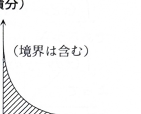

> **事前知識：面積と線積分**
>
> $y=f(x)$ と $x$ 軸で囲まれた領域の面積は、
>
> $$
> S=\int_a^b f(x)\,dx
> $$
>
> で求められる。
>
> 曲線 $C:x=x(t),y=y(t)$ に沿う線積分は、
>
> $$
> \int_C(x\,dy-y\,dx)
> =
> \int
> \left(
> x(t)y'(t)-y(t)x'(t)
> \right)dt
> $$
>
> である。
>
> 閉曲線 $\Gamma$ についてグリーンの定理を用いると、
>
> $$
> \oint_\Gamma(x\,dy-y\,dx)
> =
> 2\,\text{Area}(\Gamma)
> $$
>
> となる。

---

8C-04（重積分・線積分）

## (1)

次の領域 $R$ を図示し、その面積を求めよ。

$$
R:\sqrt{x}+\sqrt{y}\le1,
\qquad x\ge0,\ y\ge0
$$

---

## (1) 解答

> 第1象限で境界を $y$ について解き、$x$ の範囲を決めて1変数積分にする。変数変換 $\sqrt{x}=u,\sqrt{y}=v$ による2重積分でも求められるが、境界曲線が明確になる直接法を用いる。

境界は、

$$
\sqrt{x}+\sqrt{y}=1
$$

である。$y$ について解く前の式を

$$
\sqrt{y}=1-\sqrt{x}
$$

とする。第1象限で右辺が非負である必要があるから、

$$
0\le x\le1
$$

である。両辺を2乗すると、

$$
y=(1-\sqrt{x})^2
$$

であり、展開して、

$$
y=1-2\sqrt{x}+x
$$

となる。

領域は、

$$
0\le x\le1,
\qquad
0\le y\le(1-\sqrt{x})^2
$$

である。

したがって、面積は、

$$
S
=
\int_0^1(1-\sqrt{x})^2\,dx
$$

である。展開してから積分すると、

$$
S
=
\int_0^1(1-2x^{1/2}+x)\,dx
$$

$$
=
\left[
x-\frac43x^{3/2}+\frac12x^2
\right]_0^1
$$

である。$x=1$ を代入すると、

$$
1-\frac43+\frac12
$$

であり、通分すると、

$$
\frac66-\frac86+\frac36
=\frac16
$$

である。したがって、

$$
\boxed{S=\frac16}
$$

である。

---

## (2)

曲線

$$
C:x=\cos^4\theta,\qquad
y=\sin^4\theta,\qquad
0\le\theta\le\frac\pi2
$$

に沿って、次の線積分の値を求めよ。

$$
\int_C(x\,dy-y\,dx)
$$

---

## (2) 解答

> 媒介変数 $\theta$ がすでに与えられているので、$dx/d\theta$ と $dy/d\theta$ を求めて直接代入するのが自然である。資料にはグリーンの定理による別解もあるため、最後に概要を示す。

まず、

$$
x=\cos^4\theta
$$

を微分すると、

$$
\frac{dx}{d\theta}
=
4\cos^3\theta(-\sin\theta)
=-4\cos^3\theta\sin\theta
$$

である。また、

$$
y=\sin^4\theta
$$

を微分すると、

$$
\frac{dy}{d\theta}
=
4\sin^3\theta\cos\theta
$$

である。

線積分の媒介変数表示は、

$$
\int_C(x\,dy-y\,dx)
=
\int_0^{\pi/2}
\left(
x\frac{dy}{d\theta}
-
y\frac{dx}{d\theta}
\right)d\theta
$$

である。各式を代入すると、

$$
\int_0^{\pi/2}
\left[
\cos^4\theta
\cdot4\sin^3\theta\cos\theta
-
\sin^4\theta
\cdot
(-4\cos^3\theta\sin\theta)
\right]d\theta
$$

となる。整理すると、

$$
4\int_0^{\pi/2}
\left(
\sin^3\theta\cos^5\theta
+
\sin^5\theta\cos^3\theta
\right)d\theta
$$

である。共通因子をくくると、

$$
4\int_0^{\pi/2}
\sin^3\theta\cos^3\theta
(\cos^2\theta+\sin^2\theta)
\,d\theta
$$

となる。$\cos^2\theta+\sin^2\theta=1$ より、

$$
4\int_0^{\pi/2}
\sin^3\theta\cos^3\theta\,d\theta
$$

である。

$\cos^2\theta=1-\sin^2\theta$ を用いると、

$$
\sin^3\theta\cos^3\theta
=
(\sin^3\theta-\sin^5\theta)\cos\theta
$$

だから、

$$
4\int_0^{\pi/2}
(\sin^3\theta-\sin^5\theta)\cos\theta\,d\theta
$$

となる。$u=\sin\theta$ と見れば、

$$
\int\sin^3\theta\cos\theta\,d\theta
=\frac14\sin^4\theta
$$

$$
\int\sin^5\theta\cos\theta\,d\theta
=\frac16\sin^6\theta
$$

である。したがって、

$$
4\left[
\frac14\sin^4\theta
-\frac16\sin^6\theta
\right]_0^{\pi/2}
$$

となる。$\sin(\pi/2)=1$、$\sin0=0$ を代入すると、

$$
4\left(\frac14-\frac16\right)
$$

であり、

$$
4\cdot\frac1{12}
=\frac13
$$

となる。

よって、

$$
\boxed{
\int_C(x\,dy-y\,dx)=\frac13
}
$$

である。

> **グリーンの定理による別解**
>
> 曲線 $C$ と $x$ 軸、$y$ 軸を合わせて閉曲線 $\Gamma$ を作る。座標軸上では $x\,dy-y\,dx=0$ であるため、$\Gamma$ 上の積分は $C$ 上の積分に等しい。グリーンの定理より、
>
> $$
> \oint_\Gamma(x\,dy-y\,dx)
> =
> \iint_R
> \left(
> \frac{\partial x}{\partial x}
> -
> \frac{\partial(-y)}{\partial y}
> \right)dx\,dy
> $$
>
> $$
> =\iint_R2\,dx\,dy
> =2S
> $$
>
> である。(1)の $S=\dfrac16$ を代入すると、$2S=\dfrac13$ となる。
