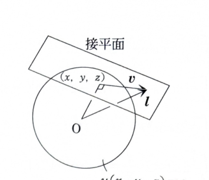

> **事前知識：勾配の幾何学的意味**
>
> 曲面が
>
> $$
> u(x,y,z)=c
> $$
>
> という等位面で表されるとき、$\operatorname{grad}u=\nabla u$ はその曲面の法線方向を向く。
>
> ベクトル $\boldsymbol v$ が
>
> $$
> \nabla u\cdot\boldsymbol v=0
> $$
>
> を満たすなら、$\boldsymbol v$ は法線ベクトルに直交するので、曲面の接平面内の接ベクトルである。

---

8C-05（ベクトルの勾配）

$$
u(x,y,z)=\sqrt{x^2+y^2+z^2}
$$

で表される関数がある。

## (1)

$\operatorname{grad}u$ を求めよ。また、求めたベクトルが

$$
u(x,y,z)=c
$$

で定義される曲面に対し、幾何学的にどのようなベクトルか述べよ。

---

## (1) 解答

> 各変数で偏微分して勾配を作る。曲面 $u=c$ は原点中心、半径 $c$ の球面なので、求めた勾配が半径方向を向くことを接平面の法線と比較して確認する。

関数をべきの形で書くと、

$$
u(x,y,z)=(x^2+y^2+z^2)^{1/2}
$$

である。

$x$ で偏微分する前の式は、

$$
\frac{\partial u}{\partial x}
=
\frac{\partial}{\partial x}
(x^2+y^2+z^2)^{1/2}
$$

である。合成関数の微分を用いると、

$$
\frac{\partial u}{\partial x}
=
\frac12(x^2+y^2+z^2)^{-1/2}\cdot2x
$$

だから、

$$
\frac{\partial u}{\partial x}
=
\frac{x}{\sqrt{x^2+y^2+z^2}}
$$

である。同様に、

$$
\frac{\partial u}{\partial y}
=
\frac{y}{\sqrt{x^2+y^2+z^2}}
$$

$$
\frac{\partial u}{\partial z}
=
\frac{z}{\sqrt{x^2+y^2+z^2}}
$$

である。

したがって、

$$
\boxed{
\operatorname{grad}u
=
\frac{1}{\sqrt{x^2+y^2+z^2}}
(x\boldsymbol i+y\boldsymbol j+z\boldsymbol k)
}
$$

である。

曲面

$$
u(x,y,z)=c
$$

は、

$$
\sqrt{x^2+y^2+z^2}=c
$$

だから、両辺を2乗すると、

$$
x^2+y^2+z^2=c^2
$$

となる。これは原点を中心とする半径 $c$ の球面である。

球面上の点 $P=(p,q,r)$ における半径方向のベクトルは、

$$
(p,q,r)
$$

である。一方、その点での勾配は、

$$
\operatorname{grad}u(P)
=
\frac1{\sqrt{p^2+q^2+r^2}}
(p,q,r)
$$

である。これは半径ベクトルの正の定数倍である。

したがって、

$$
\boxed{
\operatorname{grad}u
\text{ は曲面 }u(x,y,z)=c\text{ の法線ベクトルであり、接平面に垂直である}
}
$$

といえる。

---

## (2)

$$
\operatorname{grad}u\cdot\boldsymbol v=0
$$

を満たすベクトル $\boldsymbol v$ は、$\operatorname{grad}u$ とどのような関係にあるかを文章で説明せよ。

---

## (2) 解答

> 内積が0であることは、零ベクトルでない2つのベクトルが直交することを意味する。したがって、$\boldsymbol v$ は法線方向の勾配に直交し、接平面内にある。

条件は、

$$
\operatorname{grad}u\cdot\boldsymbol v=0
$$

である。2つのベクトル $\boldsymbol a,\boldsymbol b$ の内積は、

$$
\boldsymbol a\cdot\boldsymbol b
=
|\boldsymbol a||\boldsymbol b|\cos\theta
$$

である。ここで $\theta$ は2つのベクトルのなす角である。

$\operatorname{grad}u\ne\boldsymbol0$、$\boldsymbol v\ne\boldsymbol0$ とすると、

$$
|\operatorname{grad}u||\boldsymbol v|\ne0
$$

だから、内積が0になるためには、

$$
\cos\theta=0
$$

でなければならない。したがって、

$$
\theta=\frac\pi2
$$

である。

よって、

$$
\boxed{
\boldsymbol v\text{ は }\operatorname{grad}u\text{ と直交する}
}
$$

といえる。さらに (1) より $\operatorname{grad}u$ は球面の法線なので、

$$
\boxed{
\boldsymbol v\text{ は曲面 }u(x,y,z)=c\text{ の接平面内の接ベクトルである}
}
$$

ともいえる。

---

## (3)

次のベクトル $\boldsymbol l$ と曲面

$$
u(x,y,z)=c
$$

との幾何学的関係を図示して述べよ。ただし、$\boldsymbol v$ は (2) で定義されるベクトルである。

$$
\boldsymbol l
=
x\boldsymbol i+y\boldsymbol j+z\boldsymbol k
+\boldsymbol v
$$

---

## (3) 解答

> $x\boldsymbol i+y\boldsymbol j+z\boldsymbol k$ は球面上の点 $P=(x,y,z)$ の位置ベクトルである。そこに接ベクトル $\boldsymbol v$ を加えると、接平面上の別の点への位置ベクトルが得られる。

球面上の点を

$$
P=(x,y,z)
$$

とする。原点 $O$ から $P$ への位置ベクトルは、

$$
\overrightarrow{OP}
=
x\boldsymbol i+y\boldsymbol j+z\boldsymbol k
$$

である。

(2)より、$\boldsymbol v$ は点 $P$ における接平面内のベクトルである。したがって、ベクトル和

$$
\boldsymbol l
=
\overrightarrow{OP}+\boldsymbol v
$$

は、原点から「点 $P$ から接平面内に $\boldsymbol v$ だけ移動した点」への位置ベクトルを表す。

したがって、

$$
\boxed{
\boldsymbol l\text{ は曲面 }u(x,y,z)=c\text{ の点 }P\text{ における接平面上の点の位置ベクトルを表す}
}
$$

である。
