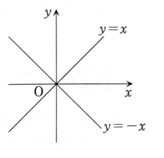

> **事前知識：極座標と曲面積**
>
> 極座標
>
> $$
> x=r\cos\theta,\qquad y=r\sin\theta
> $$
>
> では、
>
> $$
> dx\,dy=r\,dr\,d\theta
> $$
>
> である。また、
>
> $$
> x^2-y^2=r^2(\cos^2\theta-\sin^2\theta)
> =r^2\cos2\theta
> $$
>
> である。
>
> 曲面 $z=f(x,y)$ の面積は、
>
> $$
> S=\iint_D
> \sqrt{
> 1+\left(\frac{\partial f}{\partial x}\right)^2
> +\left(\frac{\partial f}{\partial y}\right)^2
> }
> \,dx\,dy
> $$
>
> で求める。

---

8C-08（重積分・曲面積）

2変数関数

$$
z=x^2-y^2
$$

について答えよ。

## (1)

曲面の $xy$ 平面 $z=0$ による切り口はどのような図形になるか。方程式と図で説明せよ。

---

## (1) 解答

> 切り口では曲面の式に $z=0$ を代入する。差の平方を因数分解すると2本の直線が得られる。

曲面の方程式は、

$$
z=x^2-y^2
$$

である。$xy$ 平面では、

$$
z=0
$$

だから、代入すると、

$$
0=x^2-y^2
$$

となる。差の平方として因数分解すると、

$$
x^2-y^2=(x-y)(x+y)
$$

だから、

$$
(x-y)(x+y)=0
$$

である。したがって、

$$
x-y=0
$$

または

$$
x+y=0
$$

であり、

$$
y=x
$$

または

$$
y=-x
$$

を得る。

よって、切り口は

$$
\boxed{y=x\text{ と }y=-x\text{ の2本の直線}}
$$

である。

---

## (2)

曲面、柱面

$$
x^2+y^2=1
$$

および $xy$ 平面 $z=0$ で囲まれる立体

$$
0\le z\le x^2-y^2,
\qquad
x^2+y^2\le1
$$

の体積を求めよ。

---

## (2) 解答

> 高さ $x^2-y^2$ が非負となる領域だけを積分する。$x^2-y^2\ge0$ は2つの対称な扇形を与えるため、右側の扇形を積分して2倍する。極座標では被積分関数が $r^2\cos2\theta$ となる。

高さが非負である条件は、

$$
x^2-y^2\ge0
$$

である。因数分解すると、

$$
(x-y)(x+y)\ge0
$$

である。右半平面 $x\ge0$ では、

$$
-x\le y\le x
$$

となる。この右側の扇形を $D$ とすると、

$$
D:
x\ge0,\quad -x\le y\le x,\quad x^2+y^2\le1
$$

である。左側にも同じ体積の部分があるため、全体の体積は、

$$
V=2\iint_D(x^2-y^2)\,dx\,dy
$$

である。

極座標を用いると、右側の扇形は、

$$
0\le r\le1,
\qquad
-\frac\pi4\le\theta\le\frac\pi4
$$

に移る。また、

$$
x^2-y^2=r^2\cos2\theta
$$

および

$$
dx\,dy=r\,dr\,d\theta
$$

だから、

$$
V
=
2\int_{-\pi/4}^{\pi/4}
\int_0^1
r^2\cos2\theta\cdot r\,dr\,d\theta
$$

となる。すなわち、

$$
V
=
2\int_{-\pi/4}^{\pi/4}
\int_0^1
r^3\cos2\theta\,dr\,d\theta
$$

である。積を分離すると、

$$
V
=
2
\left(
\int_0^1r^3\,dr
\right)
\left(
\int_{-\pi/4}^{\pi/4}\cos2\theta\,d\theta
\right)
$$

となる。

$r$ の積分は、

$$
\int_0^1r^3\,dr
=
\left[\frac{r^4}{4}\right]_0^1
=\frac14
$$

である。角度の積分は、

$$
\int_{-\pi/4}^{\pi/4}\cos2\theta\,d\theta
=
\left[\frac12\sin2\theta\right]_{-\pi/4}^{\pi/4}
$$

$$
=
\frac12\{\sin(\pi/2)-\sin(-\pi/2)\}
$$

$$
=\frac12(1-(-1))
=1
$$

である。したがって、

$$
V=2\cdot\frac14\cdot1
$$

よって、

$$
\boxed{V=\frac12}
$$

である。

---

## (3)

曲面

$$
z=x^2-y^2
$$

が柱面

$$
x^2+y^2=1
$$

で切り取られる部分、すなわち

$$
z=x^2-y^2,\qquad x^2+y^2\le1
$$

の曲面積を求めよ。

---

## (3) 解答

> グラフ $z=f(x,y)$ の曲面積公式を使う。偏導関数の平方和が $4(x^2+y^2)$ となるため、極座標で半径だけの積分になる。資料では円板を4つの同じ扇形に分けて4倍している。

関数を

$$
f(x,y)=x^2-y^2
$$

とおく。偏微分する前の式は、

$$
f(x,y)=x^2-y^2
$$

である。したがって、

$$
f_x=2x
$$

$$
f_y=-2y
$$

である。

曲面積公式より、

$$
S
=
\iint_{x^2+y^2\le1}
\sqrt{1+f_x^2+f_y^2}\,dx\,dy
$$

である。偏導関数を代入すると、

$$
S
=
\iint_{x^2+y^2\le1}
\sqrt{1+(2x)^2+(-2y)^2}\,dx\,dy
$$

となる。整理すると、

$$
S
=
\iint_{x^2+y^2\le1}
\sqrt{1+4x^2+4y^2}\,dx\,dy
$$

である。

極座標では、

$$
x^2+y^2=r^2
$$

だから、

$$
S
=
\int_0^{2\pi}\int_0^1
\sqrt{1+4r^2}\,r\,dr\,d\theta
$$

となる。

角度について積分すると、

$$
S
=
2\pi\int_0^1r\sqrt{1+4r^2}\,dr
$$

である。

ここで、

$$
u=1+4r^2
$$

とおくと、

$$
du=8r\,dr
$$

だから、

$$
r\,dr=\frac18du
$$

である。積分区間は、

$$
r=0\Rightarrow u=1
$$

$$
r=1\Rightarrow u=5
$$

である。したがって、

$$
\int_0^1r\sqrt{1+4r^2}\,dr
=
\frac18\int_1^5u^{1/2}\,du
$$

となる。積分すると、

$$
\frac18
\left[
\frac23u^{3/2}
\right]_1^5
=
\frac1{12}(5^{3/2}-1)
$$

である。$5^{3/2}=5\sqrt5$ だから、

$$
\int_0^1r\sqrt{1+4r^2}\,dr
=
\frac1{12}(5\sqrt5-1)
$$

である。よって、

$$
S
=
2\pi\cdot\frac1{12}(5\sqrt5-1)
$$

したがって、

$$
\boxed{
S=\frac\pi6(5\sqrt5-1)
}
$$

である。
