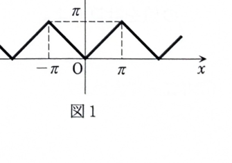

> **事前知識：周期 $2\pi$ のフーリエ級数**
>
> 周期 $2\pi$ の関数 $f(x)$ に対して、
>
> $$
> a_0=\frac1\pi\int_{-\pi}^{\pi}f(x)\,dx
> $$
>
> $$
> a_n=\frac1\pi\int_{-\pi}^{\pi}f(x)\cos nx\,dx
> $$
>
> $$
> b_n=\frac1\pi\int_{-\pi}^{\pi}f(x)\sin nx\,dx
> $$
>
> であり、
>
> $$
> f(x)\sim
> \frac{a_0}{2}
> +\sum_{n=1}^{\infty}
> (a_n\cos nx+b_n\sin nx)
> $$
>
> と表す。
>
> 偶関数では $b_n=0$ であり、
>
> $$
> \int_{-\pi}^{\pi}f(x)\cos nx\,dx
> =
> 2\int_0^\pi f(x)\cos nx\,dx
> $$
>
> を用いられる。

---

8D-01（フーリエ級数）

図に示す周期 $2\pi$ の関数

$$
y(x)=
\begin{cases}
-x & (-\pi<x\le0),\\
x & (0<x\le\pi)
\end{cases}
$$

のフーリエ級数を求めよ。

---

## 解答

> 与えられた関数は基本区間で $y(x)=|x|$ に等しく、偶関数である。したがって正弦係数はすべて0で、定数項と余弦係数だけを求めればよい。区分ごとに積分する方法もあるが、偶関数の対称性を使う方が簡潔である。

まず、定数係数は、

$$
a_0
=
\frac1\pi
\int_{-\pi}^{\pi}y(x)\,dx
$$

である。$y(x)$ は偶関数なので、

$$
a_0
=
\frac2\pi
\int_0^\pi y(x)\,dx
$$

となる。$0<x\le\pi$ では $y(x)=x$ だから、

$$
a_0
=
\frac2\pi
\int_0^\pi x\,dx
$$

である。積分すると、

$$
a_0
=
\frac2\pi
\left[
\frac{x^2}{2}
\right]_0^\pi
$$

$$
=
\frac2\pi\cdot\frac{\pi^2}{2}
=\pi
$$

である。

次に余弦係数は、

$$
a_n
=
\frac1\pi
\int_{-\pi}^{\pi}y(x)\cos nx\,dx
$$

である。$y(x)$ と $\cos nx$ はともに偶関数なので、その積も偶関数である。したがって、

$$
a_n
=
\frac2\pi
\int_0^\pi x\cos nx\,dx
$$

となる。

部分積分を用いる。部分積分前の積分は、

$$
\int_0^\pi x\cos nx\,dx
$$

である。

$$
u=x,
\qquad
dv=\cos nx\,dx
$$

とおくと、

$$
du=dx,
\qquad
v=\frac1n\sin nx
$$

である。したがって、

$$
\int_0^\pi x\cos nx\,dx
=
\left[
\frac{x}{n}\sin nx
\right]_0^\pi
-
\frac1n\int_0^\pi\sin nx\,dx
$$

である。第1項は、

$$
\sin n\pi=0,\qquad \sin0=0
$$

なので0である。

第2項を計算すると、

$$
-\frac1n\int_0^\pi\sin nx\,dx
=
-\frac1n
\left[
-\frac1n\cos nx
\right]_0^\pi
$$

$$
=
\frac1{n^2}
[\cos nx]_0^\pi
$$

$$
=
\frac1{n^2}(\cos n\pi-\cos0)
$$

である。$\cos n\pi=(-1)^n$、$\cos0=1$ だから、

$$
\int_0^\pi x\cos nx\,dx
=
\frac{(-1)^n-1}{n^2}
$$

となる。よって、

$$
a_n
=
\frac2\pi
\frac{(-1)^n-1}{n^2}
$$

である。符号をまとめると、

$$
a_n
=
-\frac2\pi
\frac{1-(-1)^n}{n^2}
$$

である。

$n$ が偶数のとき、

$$
(-1)^n=1
$$

なので、

$$
a_n=0
$$

である。$n$ が奇数のとき、

$$
(-1)^n=-1
$$

なので、

$$
a_n
=
-\frac2\pi
\frac{2}{n^2}
=
-\frac4{\pi n^2}
$$

である。

正弦係数は、

$$
b_n
=
\frac1\pi
\int_{-\pi}^{\pi}y(x)\sin nx\,dx
$$

である。$y(x)$ は偶関数、$\sin nx$ は奇関数なので積は奇関数であり、

$$
b_n=0
$$

である。

したがって、フーリエ級数は、

$$
y(x)
\sim
\frac{a_0}{2}
+
\sum_{n=1}^{\infty}a_n\cos nx
$$

である。$a_0=\pi$ を代入し、奇数 $n=2m-1$ だけを残すと、

$$
y(x)
\sim
\frac\pi2
-
\frac4\pi
\sum_{m=1}^{\infty}
\frac{\cos(2m-1)x}{(2m-1)^2}
$$

となる。

よって、

$$
\boxed{
y(x)
\sim
\frac\pi2
-
\frac4\pi
\sum_{m=1}^{\infty}
\frac{\cos(2m-1)x}{(2m-1)^2}
}
$$

である。
