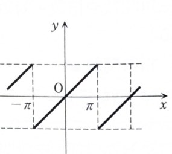

> **事前知識：周期 $2L$ のフーリエ級数**
>
> 周期 $2L$ の関数 $f(x)$ に対して、
>
> $$
> a_0=\frac1L\int_{-L}^{L}f(x)\,dx
> $$
>
> $$
> a_n=\frac1L\int_{-L}^{L}f(x)\cos\frac{n\pi x}{L}\,dx
> $$
>
> $$
> b_n=\frac1L\int_{-L}^{L}f(x)\sin\frac{n\pi x}{L}\,dx
> $$
>
> とおく。連続点では、
>
> $$
> f(x)=\frac{a_0}{2}
> +\sum_{n=1}^{\infty}
> \left(
> a_n\cos\frac{n\pi x}{L}
> +b_n\sin\frac{n\pi x}{L}
> \right)
> $$
>
> が成り立つ。
>
> 奇関数では $a_0=a_n=0$、偶関数では $b_n=0$ となる。

---

例題 4（フーリエ解析）

## (1)

次の周期 $2\pi$ の周期関数をフーリエ展開せよ。

$$
f(x)=x\qquad(-\pi<x<\pi)
$$

---

## (1) 解答

> $f(x)=x$ は奇関数なので、定数項と余弦項はすべて0になる。したがって正弦係数 $b_n$ だけを計算すればよい。一般公式を全部計算する方法もあるが、対称性を先に利用する方が簡潔で誤りが少ない。

周期は $2\pi$ なので $L=\pi$ であり、係数は

$$
a_0=\frac1\pi\int_{-\pi}^{\pi}f(x)\,dx
$$

$$
a_n=\frac1\pi\int_{-\pi}^{\pi}f(x)\cos nx\,dx
$$

$$
b_n=\frac1\pi\int_{-\pi}^{\pi}f(x)\sin nx\,dx
$$

である。

$f(x)=x$ は奇関数であるから、

$$
a_0=0,\qquad a_n=0
$$

である。一方、$x\sin nx$ は奇関数と奇関数の積なので偶関数である。したがって、

$$
b_n=\frac2\pi\int_0^\pi x\sin nx\,dx
$$

となる。

部分積分の公式

$$
\int u\,dv=uv-\int v\,du
$$

を用いる。ここで、

$$
u=x,\qquad dv=\sin nx\,dx
$$

とおくと、

$$
du=dx,\qquad v=-\frac1n\cos nx
$$

である。よって、

$$
\int_0^\pi x\sin nx\,dx
=
\left[-\frac{x}{n}\cos nx\right]_0^\pi
+\frac1n\int_0^\pi\cos nx\,dx
$$

となる。第2項は、

$$
\frac1n\int_0^\pi\cos nx\,dx
=\frac1{n^2}[\sin nx]_0^\pi
=0
$$

である。また、

$$
\left[-\frac{x}{n}\cos nx\right]_0^\pi
=-\frac{\pi}{n}\cos n\pi
$$

であり、

$$
\cos n\pi=(-1)^n
$$

だから、

$$
\int_0^\pi x\sin nx\,dx
=-\frac{\pi}{n}(-1)^n
=\frac{\pi}{n}(-1)^{n-1}
$$

である。したがって、

$$
b_n
=\frac2\pi\cdot\frac{\pi}{n}(-1)^{n-1}
=\frac2n(-1)^{n-1}
$$

となる。

よって、フーリエ級数は

$$
\boxed{
f(x)\sim
\sum_{n=1}^{\infty}
\frac2n(-1)^{n-1}\sin nx
}
$$

である。

---

## (2)

$x=\dfrac{\pi}{2}$ とおいて、次の式を導け。

$$
\pi=4\left(1-\frac13+\frac15-\cdots\right)
$$

---

## (2) 解答

> (1)で得たフーリエ級数に $x=\dfrac\pi2$ を代入する。偶数番号の正弦は0になり、奇数番号だけが交代符号で残るため、ライプニッツ級数が得られる。

(1)の式は、

$$
f(x)=
\sum_{n=1}^{\infty}
\frac2n(-1)^{n-1}\sin nx
$$

である。代入前の式に

$$
x=\frac\pi2
$$

を代入すると、

$$
f\left(\frac\pi2\right)
=
\sum_{n=1}^{\infty}
\frac2n(-1)^{n-1}
\sin\frac{n\pi}{2}
$$

である。左辺は $f(x)=x$ だから、

$$
f\left(\frac\pi2\right)=\frac\pi2
$$

である。

$n$ が偶数なら、

$$
\sin\frac{n\pi}{2}=0
$$

である。$n=2k-1$ と置くと、

$$
\sin\frac{(2k-1)\pi}{2}=(-1)^{k-1}
$$

である。また、

$$
(-1)^{(2k-1)-1}=(-1)^{2k-2}=1
$$

だから、

$$
\frac\pi2
=
\sum_{k=1}^{\infty}
\frac{2}{2k-1}(-1)^{k-1}
$$

となる。右辺を展開すると、

$$
\frac\pi2
=2\left(1-\frac13+\frac15-\frac17+\cdots\right)
$$

両辺を2倍して、

$$
\boxed{
\pi=4\left(1-\frac13+\frac15-\frac17+\cdots\right)
}
$$

を得る。
